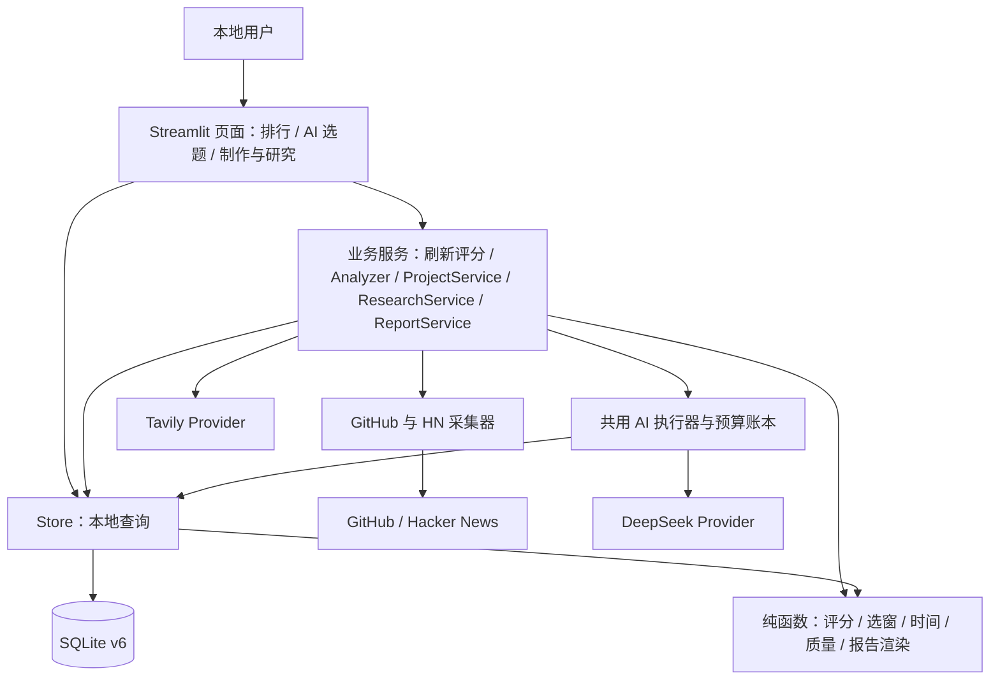

# ai-hotspot-radar 项目架构

> 基准日期：2026-11-06（北京时间）。本文描述 `E:\one\ai-hotspot-radar` 当前工作区，包含既有未提交和未跟踪实现，不代表仅 HEAD 提交的状态。

## 项目定位与初衷

项目是面向个人内容创作者的 AI 选题与资料研究工具。早期目标是用公开信息采集、统一格式、去重存储和中文页面，降低寻找 AI 工具、应用及开源项目选题的成本；来源指标应保留原始含义，不能把有限样本表述成全网排行榜。依据：[README.md](../README.md#L1)、[docs/plan&report/PLAN.md](plan%26report/PLAN.md#L1)。

最终愿景是持续发现热点、判断价值、筛选视频选题、研究事实和证据、辅助内容生产，并根据发布效果改进选题。它是目标状态，不能作为当前功能完成的证据。产品原型和长期构想见 [产品理想形态说明](AI热点雷达产品理想形态说明.docx)；本套文档只记录能从实现和审计证据确认的当前架构。

## 当前能力状态

| 能力 | 状态 | 当前边界和依据 |
| --- | --- | --- |
| GitHub 与 Hacker News 采集、去重、快照与历史展示 | 已实现 | 按钮触发、有限样本；[collectors/github.py · collect](../collectors/github.py#L12)、[collectors/hacker_news.py · collect](../collectors/hacker_news.py#L31)、[database/store.py · HotspotStore.save](../database/store.py#L58) |
| 趋势、双评分、排行和离线重算 | 已实现 | 确定性启发式，非流量预测；[services/scoring.py · score_hotspot](../services/scoring.py#L58) |
| AI 解读、三个视频角度、选题状态和预算 | 已实现 | 标题、钩子、大纲和核验清单；不等于完整脚本；[services/ai/analyzer.py · Analyzer.analyze](../services/ai/analyzer.py#L85)、[services/ai/schemas.py](../services/ai/schemas.py#L1) |
| 制作任务、人工状态、审计和内容版本 | 已实现 | 状态不代表对应内容已生成；[services/production/project_service.py · ProjectService](../services/production/project_service.py#L29)、[services/production/version_service.py · VersionService](../services/production/version_service.py#L24) |
| 研究计划、确认、Tavily 搜索和提取 | 已实现 | 计划确认不会自动搜索；[services/research/service.py · ResearchService](../services/research/service.py#L34) |
| v3 证据校验、报告生成、版本发布及人工确认 | 已实现 | 有真实服务层成功与失败记录；不保证任意题材稳定产出；[REPORT_VERIFY_V3_2026-11-05.md](../REPORT_VERIFY_V3_2026-11-05.md#L1) |
| 高可信独立事实审核能力 | 部分实现 | 已有程序等级判定；生产公开入口不授予 `verified`，缺少可信独立审核供给；[services/research/quality.py · assess_batch](../services/research/quality.py#L463) |
| 从选题到视频成品的制作流程 | 部分实现 | 已有任务、研究、版本和门禁；脚本、分镜、素材、剪辑指导业务页面仍占位；[pages/production.py · _details](../pages/production.py#L103) |
| 长期机会情报平台 | 部分实现 | 已保存历史数据，未形成跨领域趋势、竞争和商业效果分析工作流；[database/store.py · HotspotStore.history](../database/store.py#L156)、[database/research_store.py · ResearchStore.source_changes](../database/research_store.py#L89) |
| 后台持续监测、更多热点来源、完整内容生成、发布效果闭环、账号协作和收费 | 计划实现 | 当前主入口和服务目录没有对应完整实现；见产品理想形态说明及 [模块边界](architecture/MODULE_DESIGN.md) |

状态定义：**已实现**表示源码及对应测试、数据结构或报告证明存在；**部分实现**表示有基础或部分步骤，但目标链路未完整；**计划实现**表示只有规划或构想。真实调用的稳定性、视觉验收和商业有效性另列验证状态，不与实现状态混用。

## 总体架构

当前是 Python 模块化单体：Streamlit 页面、服务与 SQLite 存储在同一应用进程内协作。模块有分层，但页面可直接查询 Store，部分服务直接使用 SQL，数据库层也依赖业务校验模块，不能描述为严格单向的纯分层架构。

实际运行路径与依赖见 [系统总览](architecture/SYSTEM_OVERVIEW.md)，各模块接口见 [模块设计](architecture/MODULE_DESIGN.md)。外部请求通常同步运行，HN 详情请求内部最多 6 线程；没有后台 Worker 或任务队列。

## 技术栈概览

- 本机项目解释器 Python **3.13.12**；项目没有独立 `requires-python` 声明。已安装的 Streamlit 固定版本元数据要求 Python ≥3.11，不能据此声称全部 Python 3.11 环境已测试。
- 直接依赖：Streamlit 1.66.1、requests 2.34.2、python-dotenv 1.2.4、pytest 9.2.0、jsonschema 4.26.0。
- SQLite 为标准库，当前项目解释器链接版本为 **3.51.1**；`Schema v6` 指项目结构版本，不是 SQLite 引擎版本。
- AI REST 实现是 DeepSeek；搜索与正文提取 REST 实现是 Tavily。模型目录、模式和价格均为代码中的配置快照，未在本次联网核验。

配置默认值、用途和有证据的技术选择依据见 [技术栈](architecture/TECH_STACK.md)。本次未读取 `.env`，不能确认正在运行的进程实际使用了哪些覆盖值。

## 核心业务流程

图中的箭头表示可用衔接，不表示系统自动连续执行。每个外部调用都有独立触发入口；报告确认后的脚本状态只表示制作进度标记。六条完整流程、事务与异常处理见 [数据流](architecture/DATA_FLOW.md)。

## 数据库概览

默认文件为 `data/hotspots.sqlite3`。本次直接只读检查确认：`user_version=6`，22 张业务表、20 个显式索引、19 个触发器；`sqlite_sequence` 为额外的 SQLite 内部表，计数不包含它和自动索引。

- 热点域：`hotspots`、`collection_runs`、`hotspot_snapshots`、`hotspot_scores`。
- AI 域：`topic_analyses`、`ai_analysis_runs`、`video_ideas`、`idea_actions`、`ai_budget_settings`。
- 制作域：`production_projects`、`production_actions`、`production_objects`、`production_versions`。
- 研究域：计划确认、搜索运行与请求、来源及问题关联、证据及引用、报告确认、失败诊断，共 9 表。

研究计划和报告保存在 `production_versions.content_json`，研究模型分析与费用复用 AI 域表；没有独立 `research_reports`、`research_plans`、`scripts` 或 `feedback` 表。全表定义、关系、约束、迁移和只读审计方法见 [数据库设计](architecture/DATABASE_DESIGN.md)。

## AI 架构概览

[services/ai/executor.py · execute_attempts](../services/ai/executor.py#L12) 统一执行“逐次预占 → 单次 Provider 请求 → 本地验证及用量结算 → 业务持久化”。模型提出解读、研究计划、候选证据或报告组织结构；程序负责合法性、来源绑定、等级与时间核验、确定性渲染及事务门禁。最终报告确认由本地人工交互单独产生，不能用模型 JSON 代替。

选题与研究共用人民币月预算，Tavily credits 独立记录；未知费用保留预占，非自动归零。人工确认不提升证据等级，也不认证来源事实为真。详见 [AI 架构](architecture/AI_ARCHITECTURE.md)。

## 文档导航

| 文档 | 作用 |
| --- | --- |
| [系统总览](architecture/SYSTEM_OVERVIEW.md) | 目录、部署与运行、分层及实际依赖 |
| [模块设计](architecture/MODULE_DESIGN.md) | 模块职责、接口、输入输出、状态与测试 |
| [数据流](architecture/DATA_FLOW.md) | A—F 六条流程、事务、外部请求和确认节点 |
| [数据库设计](architecture/DATABASE_DESIGN.md) | 实库 ER、22 张表定义、全部索引与触发器 |
| [技术栈](architecture/TECH_STACK.md) | 版本、用途、配置与技术选择证据 |
| [AI 架构](architecture/AI_ARCHITECTURE.md) | Provider、Prompt、校验、重试、成本与信任边界 |
| [测试架构](architecture/TEST_ARCHITECTURE.md) | 测试分层、现有历史结果及覆盖限制 |
| [架构审计报告](ARCHITECTURE_AUDIT_REPORT.md) | 证据清单、问题优先级、验收与安全边界 |

## 当前架构状态与维护规则

当前结构适合本地单用户研究和选题辅助，具备历史追溯、预算和校验门禁；不能视为已完成内容生产与发布效果学习的产品。现有真实验证记录同时包含成功和材料结构敏感的失败案例，参见 [REPORT_VERIFY_V3_2026-11-05.md](../REPORT_VERIFY_V3_2026-11-05.md#L1)。

架构问题统一登记在审计报告。后续修改入口、服务接口、状态机、JSON 契约、数据库迁移或测试隔离机制时，同步更新相应专题及本页能力状态。数据库事实以实际 `sqlite_master` / PRAGMA 为准；旧阶段计划与验收报告保留时间语境，不直接作为当前行为说明。

本文不替代已有 README 的操作说明。已有文档本次全部保留，不修正其中过时内容；不一致项见审计报告。
