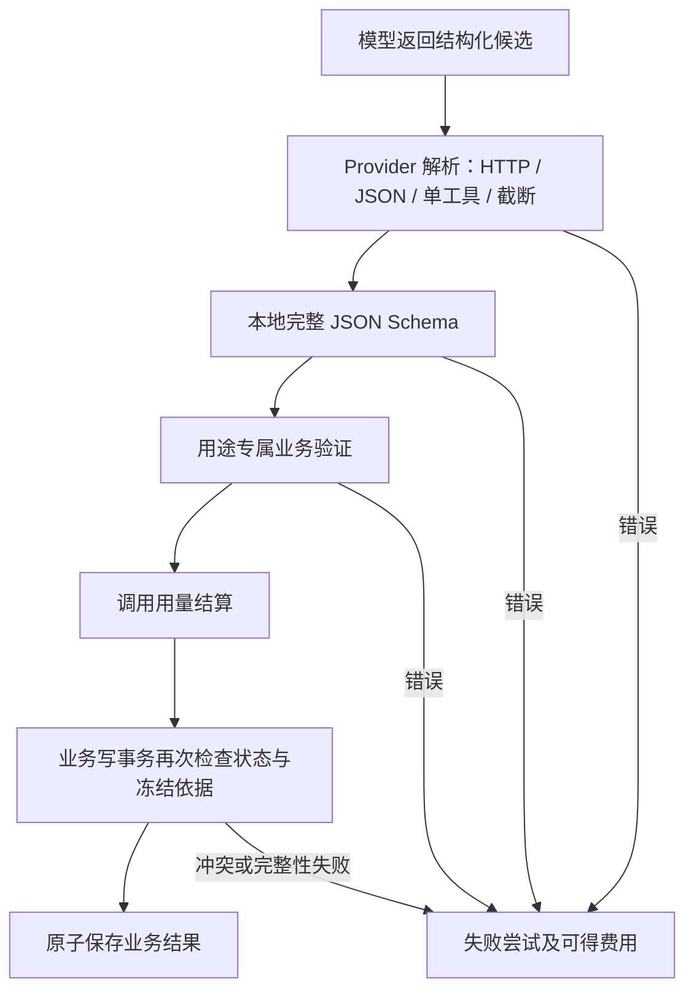

# AI 架构与安全边界

> 基准：2026-11-06（北京时间）。[架构总入口](../ARCHITECTURE.md)。仅审计本地实现和历史验收记录，未调用模型、搜索或其他外部 API。

## 模型调用入口

| 用途 | 页面触发 | 服务入口 | 成功产物与版本 |
| --- | --- | --- | --- |
| 热点选题 | AI 页单条或批量费用确认及执行 | `Analyzer.analyze` | `topic-analysis-v1 / topic-schema-v1 / topic-prompt-v1`；分析与三个选题 |
| 研究计划 | 研究计划区费用确认及生成 | `ResearchService.generate_plan → _generate` | `research-v2 / research-plan-v2 / research-prompt-v2`；plan 版本 |
| 研究证据 | 证据区费用确认及整理 | `ResearchService.organize_evidence → _generate` | `research-v3 / research-evidence-v3 / research-evidence-prompt-v3`；证据、引用和缺口 |
| 研究报告 | 报告区费用确认及生成 | `ResearchService.generate_report → ReportService.generate` | `research-report-v3 / research-report-prompt-v3`；程序渲染的报告版本 |

证据质量策略为 `quality-v3`；报告校验、渲染与哈希策略为 `report-validation-v3`、`report-render-v3`、`canonical-json-sha256-v1`。这些标识与 SQLite Schema v6 是不同版本维度。

依据：[services/ai/config.py](../../services/ai/config.py#L1)、[services/ai/analyzer.py · Analyzer.analyze](../../services/ai/analyzer.py#L85)、[services/research/service.py · ResearchService._generate](../../services/research/service.py#L252)、[services/research/report_contract.py](../../services/research/report_contract.py#L1)、[services/research/report_service.py · ReportService.generate](../../services/research/report_service.py#L142)。

## Provider 与搜索抽象

`Provider` 协议只定义 `name` 和 `complete(messages) → ProviderReply`。回复包含结构化 `document`、可空 `Usage` 和响应模型名；`AIError` 携带固定安全错误、是否可重试、可得用量及有限诊断。生产实现 `DeepSeekProvider` 用 requests 发送非流式 REST 请求，没有模型 SDK。`MockProvider` 只供测试显式注入，生产页面无虚构结果回退。

`strict` 模式向 `https://api.deepseek.com/beta/chat/completions` 注册唯一的结果提交工具，并强制该工具；`json_object` 使用普通端点及响应格式。工具只是结构化结果载体，程序不会执行模型输出中的工具调用。模型没有浏览器、shell、文件或额外网页访问能力；搜索由 Python 服务另行调用 Tavily。

搜索协议定义 `search/extract` 与可用标记，实际研究流程还调用 `usage()`。`TavilyProvider` 实现了 usage，但 `SearchProvider` 协议缺少该方法，是已记录的接口缺口 A02。Provider 可替换表示有注入接缝，不能据此声称其他供应商已接入或验证。

依据：[services/ai/base.py · Provider](../../services/ai/base.py#L50)、[services/ai/base.py · ProviderReply](../../services/ai/base.py#L30)、[services/ai/deepseek_client.py · request_body](../../services/ai/deepseek_client.py#L14)、[services/ai/deepseek_client.py · DeepSeekProvider.complete](../../services/ai/deepseek_client.py#L40)、[services/ai/mock.py · MockProvider](../../services/ai/mock.py#L8)、[services/research/base.py · SearchProvider](../../services/research/base.py#L49)、[services/research/tavily.py · TavilyProvider](../../services/research/tavily.py#L31)。

## Prompt 管理与不可信数据

选题 Prompt 在 `services/ai/prompts.py`；研究有固定计划系统规则和专用 `EVIDENCE_SYSTEM_V3`、`REPORT_SYSTEM_V3`。外部材料通过 user 消息中的 JSON 数据传入，不拼进固定 system 规则。Prompt 明确区分材料声称、事实、推断和缺口，禁止修改 A/B 分数、编造增长、声称亲测或访问未提供页面。

材料边界是减少注入风险的措施，不是语义真实性证明。选题本地主要校验形状、数量、去重和时长，不逐句验证全部自由文本事实。证据有更严格程序检查，报告则没有自由正文通道。

账本保存 Prompt 版本和输入 JSON，但没有持久化完整 system Prompt 文本/内容 hash。提示词内容变化若不更新版本，旧账本难以精确重放；研究缓存指纹也没有包含实际 Prompt 内容 hash，详见问题 A04。

依据：[services/ai/prompts.py · build_messages](../../services/ai/prompts.py#L21)、[services/research/prompts.py · messages](../../services/research/prompts.py#L69)、[services/ai/analyzer.py · Analyzer.fingerprint](../../services/ai/analyzer.py#L53)、[database/ai_store.py · AIStore.claim_analysis](../../database/ai_store.py#L67)。

## 输出校验的层次

### 选题与计划

`provider_schema` 递归删除服务商不支持的长度/数组上限约束，本地完整 Schema 仍保留。选题要求恰好三个角度，类型/标题/钩子不能相同；主标题和两个备用标题不重复；每个大纲总时长 60—90 秒。计划检查日期、问题 ID、域名和最终 query，避免模型结果直接成为未经确认的搜索参数。

### 证据

`build_manifest` 从实际保存来源生成来源 hash、正文 hash、区域、可见窗口、问题关联和覆盖缺口，模型只看到窗口投影。位置基于原始 `text/snippet` Unicode 码点，不清洗后重新计数。程序校验问题集合、总量、逐字引句、窗口/区域/字段、数字与单位、期间上下文、事件性质和来源依赖。

同题唯一可见匹配可纠正定位；多个匹配或不可见引句拒绝。来源标题和 metadata 不能当正文证据，搜索摘录只能形成受限线索。多个域名不等于来源独立；程序保守区分 `single_source`、`opinion`、`inference`、`disputed`、`unverified`。

公开 `assess_batch` 不接收可信审核回调，**生产不能授予 `verified`**。内部 `_review_gate` 仅供隔离策略测试模拟未来前提，不能通过 JSON、环境或配置打开。已有人审核报告也不等于逐条事实获得独立认证；历史 v1 的 verified 行保留但不能直接用于新的 v3 报告。

证据写入事务再次执行公开质量判定、检查冻结输入和当前数据库来源，并核对规范结果，防止绕过服务层直接写入被伪造的 quality。SQL 保存查询投影，JSON 保存角色、窗口、时间和质量细节；读取也检查二者一致性。

### 报告

`read_bundle` 用同一连接读取当前计划确认、最新搜索和最新成功证据批次，重验 v3 证据池。模型候选只能包含分题顺序、证据/缺口顺序、固定模板和绑定 ID，没有任意正文、quote、URL、value、period、等级或确认字段。

程序继承证据原子、时间、分类和引用并生成正文；完整保留全部证据、争议与强制缺口。比较模板要求相同主体、指标、单位、基准、时间性质与覆盖等条件；不生成模型提出的任意计算。`verify_envelope` 重新渲染并逐值比较，不能仅信 `validation` 字段。

本地硬上限：每题 blocks ≤8、结论 blocks ≤10、总 blocks ≤40、每 block bindings ≤10，候选文档 ≤262144 UTF-8 字节。Prompt 为减少截断另建议全部分题 blocks ≤4、结论 ≤2；这是模型指令，不是替代本地硬上限。零证据报告可以保留完整缺口，但不产生无证据事实。

依据：[services/ai/schemas.py · validate_analysis](../../services/ai/schemas.py#L58)、[services/research/schemas.py · validate_plan](../../services/research/schemas.py#L68)、[services/research/evidence_contract.py · build_manifest](../../services/research/evidence_contract.py#L53)、[services/research/quality.py · assess_batch](../../services/research/quality.py#L463)、[database/research_store.py · ResearchStore.verify_evidence_binding](../../database/research_store.py#L231)、[services/research/report_evidence.py · read_bundle](../../services/research/report_evidence.py#L16)、[services/research/report_validation.py · validate_candidate](../../services/research/report_validation.py#L61)、[services/research/report_validation.py · verify_envelope](../../services/research/report_validation.py#L177)。

## 重试与异常处理

统一执行器 `execute_attempts` 每次尝试前调用预算预占；Provider 内无隐藏重试。配置最大尝试 1—3，默认 3。当前可重试错误包括连接超时、HTTP 429/500/503；读取超时和一般网络异常默认不重试，保留费用不确定性。指数等待基数最高 8 秒，若响应提供可解析 Retry-After，Provider 将其限制到最多 30 秒。

无效 JSON、截断、业务 Schema/证据/报告验证失败不会在该动作内自动修复或重试；主动新动作另行确认和预占。Tavily 与采集 HTTP 也无自动重试。历史真实报告中多轮失败可能来自人工新动作，不等于执行器偷偷突破重试次数。

用量保存先于业务结果：Provider 失败能取得 usage 时仍结算；本地验证失败仍计费；报告/证据/选题保存失败也不能抹掉已知费用。分析失败若仍有未知费用则为 `uncertain`；进程重启不自动重发。依据：[services/ai/executor.py · execute_attempts](../../services/ai/executor.py#L12)、[services/ai/deepseek_client.py · DeepSeekProvider.complete](../../services/ai/deepseek_client.py#L40)、[database/ai_store.py · AIStore.fail_analysis](../../database/ai_store.py#L128)。

## 费用与预算

金额用 Decimal 计算，数据库存百万分之一人民币的整数单位，向上取整；账期为 Asia/Shanghai 的月份。预算占用 = 已估算或人工核对费用 + 未知费用尝试的原预占，避免将已结算与预占重复累加。

预占按完整请求 UTF-8 字节数加 4096 输入 Token 余量、输出 Token 上限和配置最高输入单价估计；不是实际 tokenizer 计数，也不是供应商最终账单保证。每次发送前在 `BEGIN IMMEDIATE` 中重新检查本月剩余额度并写 pending 尝试，默认人民币月预算 100 元只首次初始化，后续数据库修改不被环境默认覆盖。

用量缺失保留未知；缓存细分缺失或不一致时对已知输入总量按未命中保守估算。价格版本和单价/汇率快照随尝试存储。达到预算无法预占新尝试；70% 与 90% 阈值分别提示警告和高风险。

人工确认原请求停止后可以解除 running 状态，但未知费用继续预占；核对服务商账单并提供至少 8 字符依据后才填写 `manual_cost_units`。这些是本地核对记录，不是服务商账单自动拉取。

Tavily credits 用 TEXT 保存可得十进制计量，与人民币/Token 分开；缺失值不当零。当前只有配额读取和单轮上限检查，没有跨项目原子预占和硬月度 Tavily 预算。依据：[services/ai/cost_tracker.py](../../services/ai/cost_tracker.py#L1)、[database/ai_store.py · AIStore._budget](../../database/ai_store.py#L33)、[database/ai_store.py · AIStore.reserve_attempt](../../database/ai_store.py#L96)、[database/ai_store.py · AIStore.resolve_cost](../../database/ai_store.py#L218)、[database/research_store.py · ResearchStore.search_usage](../../database/research_store.py#L52)。

费用确认主要由页面交互承担，服务层强制的是配置、预算、幂等与结果校验；不能将普通脚本直接调用服务解释成已经具备用户身份与付费授权系统。报告确认另有下述本地 intent 门禁。

## 缓存、幂等与并发

- topic 缓存键包含材料、Provider、模型、输出模式及分析/Prompt/Schema 版本；时钟自然导致的 stale 不单独形成新收费版本。
- action_id 唯一约束与持久化材料锁防重复提交；`running/uncertain` 缓存键有部分唯一索引。
- 研究计划/证据/报告使用各自动作和冻结依据，新动作追加历史；报告发布用预期前版本 CAS。
- 报告确认需要本地注册的 intent，与项目、版本、hash、用途、session、nonce 绑定。普通 UUID 只用于去重，不是权限凭据。

依据：[services/ai/analyzer.py · Analyzer.fingerprint](../../services/ai/analyzer.py#L53)、[database/ai_store.py · AIStore.claim_analysis](../../database/ai_store.py#L67)、[services/research/service.py · ResearchService._generate](../../services/research/service.py#L252)、[services/research/report_service.py · ReportService._publish](../../services/research/report_service.py#L95)、[services/research/report_confirmation.py](../../services/research/report_confirmation.py#L1)。

## 诊断

研究模型失败按 provider/validation/persistence 分阶段记录固定代码、结构路径和有限条目索引。所有字符串值脱敏，未知键名过滤或替代，深度和数组长度有限制，拒绝结构最大 16 KiB；无法保留完整结构时明确标截断。诊断表有跨项目/分析/尝试关联触发器及只追加保护。

诊断是附属记录，写失败只记录安全错误，不改变原调用结算和失败决定。它不是原始模型输出回放存档。依据：[services/research/diagnostics.py · rejected_structure](../../services/research/diagnostics.py#L35)、[database/research_store.py · ResearchStore.save_diagnostic](../../database/research_store.py#L114)、[database/research_quality_migration.py](../../database/research_quality_migration.py#L1)。

## 安全边界与未验证内容

| 边界 | 已有实现 | 不应推导的保证 |
| --- | --- | --- |
| 提示注入 | 固定 system、材料 JSON、无执行工具、结果程序校验 | 不保证所有自由文本语义正确 |
| 来源真实性 | 引句、位置、字段、窗口、hash 与关系一致性 | 引用存在不等于现实事实为真 |
| 人工确认 | 本地交互注册对象，绑定具体版本与内容 | 不防任意本地 Python/SQL 管理员，不是多租户身份系统 |
| URL 提取 | HTTP(S)、拒绝凭据、localhost/私网 IP 字面量；本地只请求固定 Tavily 端点 | 没有 DNS 解析/重绑定及提取服务内部重定向审计，不应宣传完整 SSRF 防护 |
| 预算 | 事务预占、未知费用保留、价格快照 | 不保证供应商最终账单等于估算，不控制 Tavily 货币账单 |
| 历史 | 关键研究与制作表触发器禁止 UPDATE/DELETE | 不防具有数据库管理员权限的任意操作，也非全部表不可变 |

真实材料稳定性、模型契约遵从率、来源提取完整性、端到端浏览器确认和长期使用效果未在本次运行验证。历史成功与失败并存，详见 [REPORT_VERIFY_V3_2026-11-05.md](../../REPORT_VERIFY_V3_2026-11-05.md#L1)；问题与建议见 [审计报告](../ARCHITECTURE_AUDIT_REPORT.md)。
