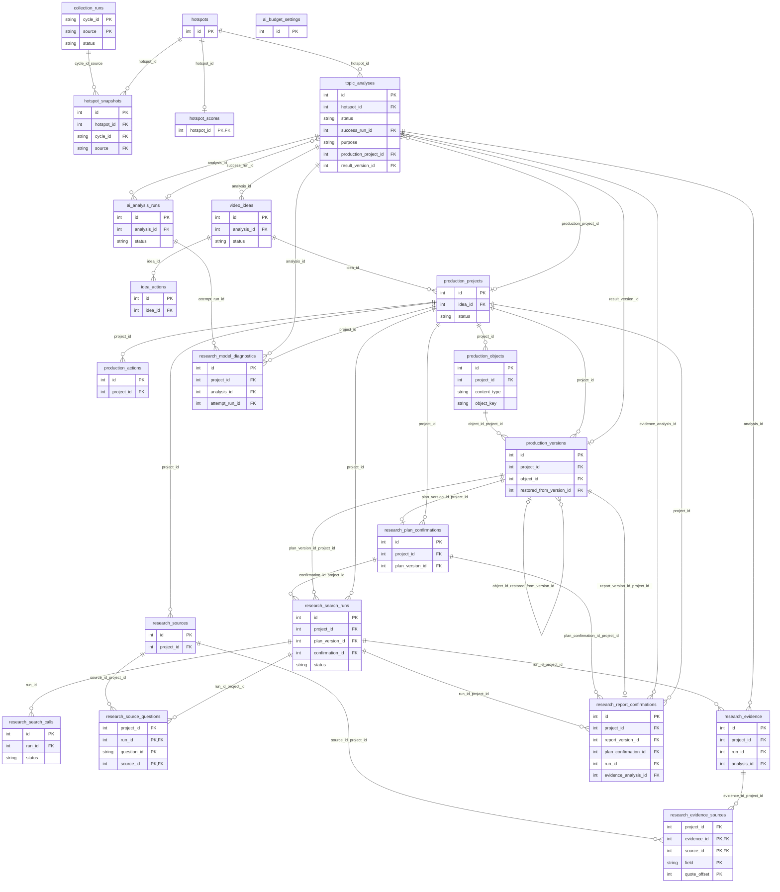

# 数据库设计与实库审计

> 审计基准：2026-11-06（北京时间），当前工作区源码与默认数据库 v6。[架构总入口](../ARCHITECTURE.md)。已实现不等于已完成生产稳定性验证。

## 审计对象与方法

审计默认数据库 `data/hotspots.sqlite3`，没有读取 `.env`，因此它是本次实库样本，不保证等同任意运行进程覆盖路径后的数据库。

确认无 `-wal/-shm/-journal` 同名伴随文件后，使用标准库 sqlite3 URI `mode=ro&immutable=1` 连接，并在同一读事务读取 `sqlite_master`、`table_xinfo`、`foreign_key_list`、`index_list/index_xinfo`、user_version、integrity_check 和 foreign_key_check。未构造 Store，未执行迁移、DDL、DML、VACUUM、checkpoint 或备份命令。immutable 不适用于被并发写入的活动库；本次用前后文件 hash 核对稳定性，不能把这种方法无条件复制到 WAL 活动库。

| 实查项 | 结果 |
| --- | --- |
| 项目 Schema | PRAGMA user_version = 6 |
| 本机 SQLite 引擎 | 3.51.1 |
| 日志模式 | delete |
| 业务表 | 22 |
| 显式索引 | 20 |
| SQLite 自动索引 | 26 |
| 触发器 | 19 |
| 完整性检查 | ok |
| 外键检查 | 0 行异常 |
| 数据库 SHA256 | 1aa87d9f6b3db7da1b17fe6d9e4a161ac57e312e5e4c42b7342e80ad99589b4a |

内部 `sqlite_sequence` 不算业务表。sqlite3 的 `foreign_keys` 是每连接开关，不能从审计只读连接的默认值推断应用未启用；应用 `_connection` 明确执行 `PRAGMA foreign_keys=ON`。

## 表职责与本次行数快照

行数是 2026-11-06 审计时点的只读统计，不代表固定容量、全部 v3 或真实有效性评级。尤其 evidence 共 39 行，其中旧 v1 30 行、新 v3 9 行；旧 v1 中有 1 行 verified，新 v3 为 3 opinion + 6 unverified。旧记录原样保留，不能把旧 verified 当作当前公开策略授信。

| 域 | 表 | 职责 | 行数 |
| --- | --- | --- | --- |
| 热点 | `hotspots` | 统一主记录、主来源与去重检索键 | 76 |
| 热点 | `collection_runs` | 单周期单来源的采集状态与统计 | 18 |
| 热点 | `hotspot_snapshots` | 真实来源对象的指标观测历史 | 338 |
| 热点 | `hotspot_scores` | 每个热点当前一份规则评分及完整解释 JSON | 76 |
| AI | `topic_analyses` | 选题和研究共用的逻辑模型操作与输入结果快照 | 48 |
| AI | `ai_analysis_runs` | 每次模型 HTTP 尝试、usage、价格快照与费用结算 | 48 |
| AI | `video_ideas` | 一个选题分析产出的三个角度与人工状态 | 9 |
| AI | `idea_actions` | 选题状态变更历史 | 5 |
| AI | `ai_budget_settings` | 本地全局人民币模型月预算上限与修改审计 JSON | 1 |
| 制作 | `production_projects` | 从 video_idea 创建的制作任务与人工状态 | 2 |
| 制作 | `production_actions` | 制作与研究事件共用追加审计 | 34 |
| 制作 | `production_objects` | 任务下内容对象的身份 | 4 |
| 制作 | `production_versions` | 完整内容版本，包括研究计划和报告 JSON | 10 |
| 研究 | `research_plan_confirmations` | 对具体计划版本的人工确认 | 5 |
| 研究 | `research_search_runs` | 一次已确认计划的搜索与提取工作流 | 6 |
| 研究 | `research_search_calls` | usage/search/extract 单次请求与响应、credits | 39 |
| 研究 | `research_sources` | 提取文本/摘录及来源元数据的不可改写快照 | 44 |
| 研究 | `research_source_questions` | 运行、研究问题与来源快照的多对多关联 | 81 |
| 研究 | `research_evidence` | 一个成功分析批次的证据 SQL 投影 | 39 |
| 研究 | `research_evidence_sources` | 证据与原始来源的物理引用 | 60 |
| 研究 | `research_report_confirmations` | 具体报告版本与当前研究依据的人工确认 | 1 |
| 研究 | `research_model_diagnostics` | 模型解析、业务验证及持久化失败的脱敏诊断 | 28 |

## ER 图

以下按实际外键生成关系。父端可空性按子外键列判定，子端至多一行时按 PK/UNIQUE 判定；复合外键按一条关系表示。同一对表的多条边对应不同外键。详细 SQL 是约束的权威定义，图不表达 CHECK、部分索引或服务层的“当前版本”条件。



## 逻辑关联与数据库未表达的条件

- 热点到选题：`hotspots → topic_analyses(purpose=topic) → video_ideas`。研究也使用 topic_analyses，但不产生三个新 video_ideas。
- 制作项目：`video_ideas → production_projects → production_objects → production_versions`，同一任务下按对象独立分配版本号。
- 研究计划、报告：`production_objects(content_type=research, object_key=plan/report)` 下的版本；**没有独立计划表或报告表**。
- 问题：存在计划 JSON 的 `questions` 中；SQL 中 question_id 的同题关联由程序核验，没有 question_id 外键目标表。
- 搜索与来源：一个 run 通过 `research_source_questions` 使用多个不可变来源快照；同快照也可被多个 run/问题复用。
- 证据：analysis 保存完整冻结 manifest、候选和规范质量结果；research_evidence 为查询投影；research_evidence_sources 为物理引用。
- 报告确认：确认行保留版本和研究依据，内容 hash、policy、nonce、origin 等存在制作审计 JSON；是否最新有效必须由服务重验。
- 数据库复合外键保护跨项目关系，但不能检查版本对象一定为 research/plan 或 research/report，也不保证某 analysis 的 purpose。当前上下文和版本语义由服务补足；诊断表另有插入关联触发器。
- `topic_analyses.production_project_id/result_version_id` 及 `success_run_id` 为普通可空外键，部分一致性由服务检查，不是数据库所有字段组合都具备复合外键。

依据：[database/research_store.py · ResearchStore.verify_evidence_binding](../../database/research_store.py#L231)、[services/research/report_evidence.py · read_bundle](../../services/research/report_evidence.py#L16)、[services/research/report_service.py · require_confirmed_report](../../services/research/report_service.py#L59)。

## 全表字段与约束

下列 CREATE TABLE SQL 来自审计时实际 `sqlite_master.sql`，完整列出字段、类型、默认值、主外键、UNIQUE、CHECK 及延迟约束；它是文档文本，**本次未执行这些建表语句**。SQLite 的 INTEGER PRIMARY KEY 对应 rowid 语义，PRAGMA 中 notnull=0 不代表主键可以作为普通 NULL 保留。

源码中 22 个 CREATE TABLE 及增量 ADD COLUMN 与实库表集合、字段名称和顺序做静态对照，22/22 一致；DDL 约束、索引与触发器另对照对应创建模块。此检查没有运行任何迁移，不是迁移行为重验。

### hotspots

统一主记录、主来源与去重检索键。id 为整数主键；normalized_url、normalized_title 分别唯一。source + primary_source_key 显式唯一，NULL source_key 不建立稳定身份。collected_at 保留首次采集，score 是来源原始累计指标，不是综合评分。

结构来源：[database/store.py](../../database/store.py#L1)；工作区建表字符串起始行 25。

```sql
CREATE TABLE hotspots (
                    id INTEGER PRIMARY KEY,
                    title TEXT NOT NULL,
                    url TEXT NOT NULL,
                    source TEXT NOT NULL CHECK(source IN ('GitHub', 'Hacker News')),
                    summary TEXT,
                    published_at TEXT,
                    collected_at TEXT NOT NULL,
                    score INTEGER CHECK(score IS NULL OR score >= 0),
                    category TEXT NOT NULL,
                    normalized_url TEXT NOT NULL UNIQUE,
                    normalized_title TEXT NOT NULL UNIQUE,
                    search_text TEXT NOT NULL
                , primary_source_key TEXT);
```

此表没有声明外键。

SQLite 自动约束索引：`sqlite_autoindex_hotspots_2` 唯一 (normalized_title)；`sqlite_autoindex_hotspots_1` 唯一 (normalized_url)。

### collection_runs

单周期单来源的采集状态与统计。复合主键 cycle_id + source；完成状态含 success/partial/failed。不是 AI 调用记录。

结构来源：[database/migrations.py](../../database/migrations.py#L1)；工作区建表字符串起始行 64。

```sql
CREATE TABLE collection_runs (
            cycle_id TEXT NOT NULL, source TEXT NOT NULL,
            started_at TEXT NOT NULL, finished_at TEXT NOT NULL,
            status TEXT NOT NULL CHECK(status IN ('success', 'partial', 'failed')),
            fetched INTEGER NOT NULL DEFAULT 0, inserted INTEGER NOT NULL DEFAULT 0,
            updated INTEGER NOT NULL DEFAULT 0, skipped INTEGER NOT NULL DEFAULT 0,
            snapshots INTEGER NOT NULL DEFAULT 0, warnings TEXT NOT NULL DEFAULT '[]', error TEXT,
            PRIMARY KEY(cycle_id, source)
        );
```

此表没有声明外键。

SQLite 自动约束索引：`sqlite_autoindex_collection_runs_1` 唯一 (cycle_id, source)。

### hotspot_snapshots

真实来源对象的指标观测历史。热点外键及延迟复合任务外键；同周期/热点/来源/对象唯一。Stars 与 HN 指标分别列保存。应用追加但无禁止 UPDATE/DELETE 的触发器，不能宣称实库强制不可变。

结构来源：[database/migrations.py](../../database/migrations.py#L1)；工作区建表字符串起始行 73。

```sql
CREATE TABLE hotspot_snapshots (
            id INTEGER PRIMARY KEY, hotspot_id INTEGER NOT NULL REFERENCES hotspots(id),
            cycle_id TEXT NOT NULL, source TEXT NOT NULL CHECK(source IN ('GitHub', 'Hacker News')),
            source_key TEXT NOT NULL, collected_at TEXT NOT NULL, url TEXT NOT NULL,
            stars INTEGER CHECK(stars IS NULL OR stars >= 0),
            forks INTEGER CHECK(forks IS NULL OR forks >= 0),
            hn_score INTEGER CHECK(hn_score IS NULL OR hn_score >= 0),
            comments INTEGER CHECK(comments IS NULL OR comments >= 0),
            published_at TEXT, pushed_at TEXT,
            UNIQUE(cycle_id, hotspot_id, source, source_key),
            FOREIGN KEY(cycle_id, source) REFERENCES collection_runs(cycle_id, source)
                DEFERRABLE INITIALLY DEFERRED
        );
```

| 外键列 | 目标 | ON UPDATE | ON DELETE |
| --- | --- | --- | --- |
| (cycle_id, source) | collection_runs(cycle_id, source) | NO ACTION | NO ACTION |
| (hotspot_id) | hotspots(id) | NO ACTION | NO ACTION |

SQLite 自动约束索引：`sqlite_autoindex_hotspot_snapshots_1` 唯一 (cycle_id, hotspot_id, source, source_key)。

### hotspot_scores

每个热点当前一份规则评分及完整解释 JSON。hotspot_id 同时为主键和外键；重算 UPSERT 覆盖当前分，不保存每次评分历史。details 冻结当次规则、维度、趋势和参数。

结构来源：[database/migrations.py](../../database/migrations.py#L1)；工作区建表字符串起始行 87。

```sql
CREATE TABLE hotspot_scores (
            hotspot_id INTEGER PRIMARY KEY REFERENCES hotspots(id),
            heat_score REAL, video_score REAL, composite_score REAL,
            calculated_at TEXT NOT NULL, rule_version TEXT NOT NULL,
            details TEXT NOT NULL, stale INTEGER NOT NULL DEFAULT 0
        );
```

| 外键列 | 目标 | ON UPDATE | ON DELETE |
| --- | --- | --- | --- |
| (hotspot_id) | hotspots(id) | NO ACTION | NO ACTION |

### topic_analyses

选题和研究共用的逻辑模型操作与输入结果快照。purpose 区分 topic/research_plan/research_evidence/research_report；研究关联 production_project_id 和可选 result_version_id。action_id 唯一；材料运行锁为部分唯一索引。success_run_id 指回尝试表，形成可空循环外键。

结构来源：[database/ai_migration.py](../../database/ai_migration.py#L1)；工作区建表字符串起始行 9。

```sql
CREATE TABLE topic_analyses (
            id INTEGER PRIMARY KEY, hotspot_id INTEGER NOT NULL REFERENCES hotspots(id),
            cache_key TEXT NOT NULL, action_id TEXT NOT NULL UNIQUE,
            provider TEXT NOT NULL, model TEXT NOT NULL, prompt_version TEXT NOT NULL,
            schema_version TEXT NOT NULL, analysis_version TEXT NOT NULL, output_mode TEXT NOT NULL,
            input_json TEXT NOT NULL, analysis_json TEXT, summary TEXT, evidence_status TEXT,
            status TEXT NOT NULL CHECK(status IN ('running','success','failed','uncertain')),
            error_type TEXT, success_run_id INTEGER REFERENCES ai_analysis_runs(id),
            created_at TEXT NOT NULL, completed_at TEXT
        , purpose TEXT NOT NULL DEFAULT 'topic' CHECK(purpose IN ('topic','research_plan','research_evidence','research_report')), production_project_id INTEGER REFERENCES production_projects(id), result_version_id INTEGER REFERENCES production_versions(id));
```

| 外键列 | 目标 | ON UPDATE | ON DELETE |
| --- | --- | --- | --- |
| (result_version_id) | production_versions(id) | NO ACTION | NO ACTION |
| (production_project_id) | production_projects(id) | NO ACTION | NO ACTION |
| (success_run_id) | ai_analysis_runs(id) | NO ACTION | NO ACTION |
| (hotspot_id) | hotspots(id) | NO ACTION | NO ACTION |

SQLite 自动约束索引：`sqlite_autoindex_topic_analyses_1` 唯一 (action_id)。

### ai_analysis_runs

每次模型 HTTP 尝试、usage、价格快照与费用结算。analysis_id + attempt 唯一。estimated_cost_units/manual_cost_units 为 NULL 时保留 reserved_units；response_model 可空。attempt 成功不等于业务分析成功。

结构来源：[database/ai_migration.py](../../database/ai_migration.py#L1)；工作区建表字符串起始行 21。

```sql
CREATE TABLE ai_analysis_runs (
            id INTEGER PRIMARY KEY, analysis_id INTEGER NOT NULL REFERENCES topic_analyses(id),
            attempt INTEGER NOT NULL, provider TEXT NOT NULL, model TEXT NOT NULL,
            prompt_version TEXT NOT NULL, schema_version TEXT NOT NULL, output_mode TEXT NOT NULL,
            response_model TEXT, price_version TEXT NOT NULL, price_json TEXT NOT NULL,
            input_tokens INTEGER, output_tokens INTEGER, cache_hit_tokens INTEGER, cache_miss_tokens INTEGER,
            estimated_cost_units INTEGER CHECK(estimated_cost_units IS NULL OR estimated_cost_units>=0),
            reserved_units INTEGER NOT NULL CHECK(reserved_units>=0),
            manual_cost_units INTEGER CHECK(manual_cost_units IS NULL OR manual_cost_units>=0),
            resolution_reason TEXT, resolved_at TEXT,
            status TEXT NOT NULL CHECK(status IN ('pending','success','failed')),
            error_type TEXT, budget_month TEXT NOT NULL, created_at TEXT NOT NULL, finished_at TEXT,
            UNIQUE(analysis_id, attempt)
        );
```

| 外键列 | 目标 | ON UPDATE | ON DELETE |
| --- | --- | --- | --- |
| (analysis_id) | topic_analyses(id) | NO ACTION | NO ACTION |

SQLite 自动约束索引：`sqlite_autoindex_ai_analysis_runs_1` 唯一 (analysis_id, attempt)。

### video_ideas

一个选题分析产出的三个角度与人工状态。position 1—3，analysis_id + position 唯一；保留完整 idea_json 及常用查询投影。未绑定制作任务的固定目标状态要求。

结构来源：[database/ai_migration.py](../../database/ai_migration.py#L1)；工作区建表字符串起始行 36。

```sql
CREATE TABLE video_ideas (
            id INTEGER PRIMARY KEY, analysis_id INTEGER NOT NULL REFERENCES topic_analyses(id),
            position INTEGER NOT NULL CHECK(position BETWEEN 1 AND 3),
            angle_type TEXT NOT NULL, title TEXT NOT NULL, hook TEXT NOT NULL,
            outline_json TEXT NOT NULL, target_audience TEXT NOT NULL, materials_json TEXT NOT NULL,
            verification_json TEXT NOT NULL, difficulty TEXT NOT NULL, recommendation_reason TEXT NOT NULL,
            idea_json TEXT NOT NULL,
            status TEXT NOT NULL DEFAULT 'new' CHECK(status IN ('new','favorite','discarded','selected','to_produce')),
            created_at TEXT NOT NULL, updated_at TEXT NOT NULL, UNIQUE(analysis_id, position)
        );
```

| 外键列 | 目标 | ON UPDATE | ON DELETE |
| --- | --- | --- | --- |
| (analysis_id) | topic_analyses(id) | NO ACTION | NO ACTION |

SQLite 自动约束索引：`sqlite_autoindex_video_ideas_1` 唯一 (analysis_id, position)。

### idea_actions

选题状态变更历史。idea_id 外键；与选题状态更新同事务。该表没有 UPDATE/DELETE 保护触发器，不等同制作审计的强制追加保护。

结构来源：[database/ai_migration.py](../../database/ai_migration.py#L1)；工作区建表字符串起始行 47。

```sql
CREATE TABLE idea_actions (
            id INTEGER PRIMARY KEY, idea_id INTEGER NOT NULL REFERENCES video_ideas(id),
            action TEXT NOT NULL, previous_status TEXT NOT NULL, created_at TEXT NOT NULL
        );
```

| 外键列 | 目标 | ON UPDATE | ON DELETE |
| --- | --- | --- | --- |
| (idea_id) | video_ideas(id) | NO ACTION | NO ACTION |

### ai_budget_settings

本地全局人民币模型月预算上限与修改审计 JSON。id CHECK=1 的单例；无按月预算行，账期由 ai_analysis_runs.budget_month 聚合。limit_units 可为 0，暂停新调用。

结构来源：[database/ai_migration.py](../../database/ai_migration.py#L1)；工作区建表字符串起始行 51。

```sql
CREATE TABLE ai_budget_settings (
            id INTEGER PRIMARY KEY CHECK(id=1), limit_units INTEGER NOT NULL CHECK(limit_units>=0),
            updated_at TEXT NOT NULL, audit_json TEXT NOT NULL DEFAULT '[]'
        );
```

此表没有声明外键。

### production_projects

从 video_idea 创建的制作任务与人工状态。同选题未归档项目唯一；completed 仍属未归档。暂停须 resume_status 合法，其余状态 resume_status 为 NULL。

结构来源：[database/production_migration.py](../../database/production_migration.py#L1)；工作区建表字符串起始行 9。

```sql
CREATE TABLE production_projects (
            id INTEGER PRIMARY KEY AUTOINCREMENT,
            name TEXT NOT NULL CHECK(length(trim(name))>0),
            idea_id INTEGER NOT NULL REFERENCES video_ideas(id),
            status TEXT NOT NULL DEFAULT 'pending' CHECK(status IN
                ('pending','researching','scripting','storyboarding','assets','editing','completed','paused','archived')),
            notes TEXT NOT NULL DEFAULT '', resume_status TEXT,
            created_at TEXT NOT NULL, updated_at TEXT NOT NULL,
            CHECK((status='paused' AND resume_status IS NOT NULL AND resume_status IN
                ('pending','researching','scripting','storyboarding','assets','editing','completed'))
                OR (status<>'paused' AND resume_status IS NULL))
        );
```

| 外键列 | 目标 | ON UPDATE | ON DELETE |
| --- | --- | --- | --- |
| (idea_id) | video_ideas(id) | NO ACTION | NO ACTION |

### production_actions

制作与研究事件共用追加审计。action_type 固定枚举，研究事件放 details_json.event；确认/校验 hash 回执也存在 details_json。UPDATE/DELETE 触发器拒绝改写。

结构来源：[database/production_migration.py](../../database/production_migration.py#L1)；工作区建表字符串起始行 24。

```sql
CREATE TABLE production_actions (
            id INTEGER PRIMARY KEY AUTOINCREMENT,
            project_id INTEGER NOT NULL REFERENCES production_projects(id),
            action_type TEXT NOT NULL CHECK(action_type IN
                ('created','updated','status_changed','paused','resumed','archived','version_created','version_restored')),
            previous_status TEXT, new_status TEXT NOT NULL,
            created_at TEXT NOT NULL, details_json TEXT NOT NULL CHECK(json_valid(details_json))
        );
```

| 外键列 | 目标 | ON UPDATE | ON DELETE |
| --- | --- | --- | --- |
| (project_id) | production_projects(id) | NO ACTION | NO ACTION |

### production_objects

任务下内容对象的身份。project_id + content_type + object_key 唯一；research/plan 与 research/report 是实际计划和报告对象。

结构来源：[database/production_migration.py](../../database/production_migration.py#L1)；工作区建表字符串起始行 33。

```sql
CREATE TABLE production_objects (
            id INTEGER PRIMARY KEY AUTOINCREMENT,
            project_id INTEGER NOT NULL REFERENCES production_projects(id),
            content_type TEXT NOT NULL CHECK(content_type IN ('research','script','storyboard','asset','editing_guide')),
            object_key TEXT NOT NULL CHECK(length(trim(object_key))>0),
            created_at TEXT NOT NULL,
            UNIQUE(project_id,content_type,object_key), UNIQUE(id,project_id)
        );
```

| 外键列 | 目标 | ON UPDATE | ON DELETE |
| --- | --- | --- | --- |
| (project_id) | production_projects(id) | NO ACTION | NO ACTION |

SQLite 自动约束索引：`sqlite_autoindex_production_objects_2` 唯一 (id, project_id)；`sqlite_autoindex_production_objects_1` 唯一 (project_id, content_type, object_key)。

### production_versions

完整内容版本，包括研究计划和报告 JSON。object_id + version_number 唯一；复合外键防跨项目对象/跨对象恢复；恢复追加并保留 restored_from_version_id。UPDATE/DELETE 被拒绝。

结构来源：[database/production_migration.py](../../database/production_migration.py#L1)；工作区建表字符串起始行 41。

```sql
CREATE TABLE production_versions (
            id INTEGER PRIMARY KEY AUTOINCREMENT,
            project_id INTEGER NOT NULL REFERENCES production_projects(id),
            object_id INTEGER NOT NULL,
            version_number INTEGER NOT NULL CHECK(version_number>0),
            content_json TEXT NOT NULL CHECK(json_valid(content_json)),
            source TEXT NOT NULL CHECK(source IN ('ai','manual','restore')),
            note TEXT NOT NULL DEFAULT '', created_at TEXT NOT NULL,
            restored_from_version_id INTEGER,
            UNIQUE(object_id,version_number), UNIQUE(object_id,id),
            FOREIGN KEY(object_id,project_id) REFERENCES production_objects(id,project_id),
            FOREIGN KEY(object_id,restored_from_version_id) REFERENCES production_versions(object_id,id),
            CHECK((source='restore' AND restored_from_version_id IS NOT NULL)
                OR (source<>'restore' AND restored_from_version_id IS NULL))
        );
```

| 外键列 | 目标 | ON UPDATE | ON DELETE |
| --- | --- | --- | --- |
| (object_id, restored_from_version_id) | production_versions(object_id, id) | NO ACTION | NO ACTION |
| (object_id, project_id) | production_objects(id, project_id) | NO ACTION | NO ACTION |
| (project_id) | production_projects(id) | NO ACTION | NO ACTION |

SQLite 自动约束索引：`sqlite_autoindex_production_versions_2` 唯一 (object_id, id)；`sqlite_autoindex_production_versions_1` 唯一 (object_id, version_number)。

### research_plan_confirmations

对具体计划版本的人工确认。action_id 唯一，project_id + plan_version_id 唯一；复合版本外键限定同项目，但对象类型和当前最新版本仍需服务检查。只追加。

结构来源：[database/research_migration.py](../../database/research_migration.py#L1)；工作区建表字符串起始行 11。

```sql
CREATE TABLE research_plan_confirmations (
            id INTEGER PRIMARY KEY, project_id INTEGER NOT NULL REFERENCES production_projects(id),
            plan_version_id INTEGER NOT NULL, action_id TEXT NOT NULL UNIQUE, confirmed_at TEXT NOT NULL,
            FOREIGN KEY(plan_version_id,project_id) REFERENCES production_versions(id,project_id),
            UNIQUE(project_id,plan_version_id), UNIQUE(id,project_id)
        );
```

| 外键列 | 目标 | ON UPDATE | ON DELETE |
| --- | --- | --- | --- |
| (plan_version_id, project_id) | production_versions(id, project_id) | NO ACTION | NO ACTION |
| (project_id) | production_projects(id) | NO ACTION | NO ACTION |

SQLite 自动约束索引：`sqlite_autoindex_research_plan_confirmations_3` 唯一 (id, project_id)；`sqlite_autoindex_research_plan_confirmations_2` 唯一 (project_id, plan_version_id)；`sqlite_autoindex_research_plan_confirmations_1` 唯一 (action_id)。

### research_search_runs

一次已确认计划的搜索与提取工作流。绑定项目、计划版本和确认；每项目 running 唯一。状态含 interrupted；不是每次 HTTP 请求明细。

结构来源：[database/research_migration.py](../../database/research_migration.py#L1)；工作区建表字符串起始行 17。

```sql
CREATE TABLE research_search_runs (
            id INTEGER PRIMARY KEY, project_id INTEGER NOT NULL REFERENCES production_projects(id),
            plan_version_id INTEGER NOT NULL, confirmation_id INTEGER NOT NULL,
            action_id TEXT NOT NULL UNIQUE, provider TEXT NOT NULL, params_json TEXT NOT NULL CHECK(json_valid(params_json)),
            status TEXT NOT NULL CHECK(status IN ('running','success','partial','failed','interrupted')),
            started_at TEXT NOT NULL, finished_at TEXT, error_type TEXT,
            FOREIGN KEY(plan_version_id,project_id) REFERENCES production_versions(id,project_id),
            FOREIGN KEY(confirmation_id,project_id) REFERENCES research_plan_confirmations(id,project_id),
            UNIQUE(id,project_id)
        );
```

| 外键列 | 目标 | ON UPDATE | ON DELETE |
| --- | --- | --- | --- |
| (confirmation_id, project_id) | research_plan_confirmations(id, project_id) | NO ACTION | NO ACTION |
| (plan_version_id, project_id) | production_versions(id, project_id) | NO ACTION | NO ACTION |
| (project_id) | production_projects(id) | NO ACTION | NO ACTION |

SQLite 自动约束索引：`sqlite_autoindex_research_search_runs_2` 唯一 (id, project_id)；`sqlite_autoindex_research_search_runs_1` 唯一 (action_id)。

### research_search_calls

usage/search/extract 单次请求与响应、credits。run_id + operation + question_id 唯一；批量提取和 usage 使用空 question_id。credits 为 TEXT，可空，不与人民币混算。请求与响应 JSON 可包含公开研究内容，不是脱敏诊断。

结构来源：[database/research_migration.py](../../database/research_migration.py#L1)；工作区建表字符串起始行 29。

```sql
CREATE TABLE research_search_calls (
            id INTEGER PRIMARY KEY, run_id INTEGER NOT NULL REFERENCES research_search_runs(id),
            operation TEXT NOT NULL CHECK(operation IN ('usage','search','extract')), question_id TEXT NOT NULL,
            request_json TEXT NOT NULL CHECK(json_valid(request_json)), response_json TEXT,
            request_id TEXT, credits TEXT,
            status TEXT NOT NULL CHECK(status IN ('pending','success','partial','failed')),
            created_at TEXT NOT NULL, finished_at TEXT, error_type TEXT,
            UNIQUE(run_id,operation,question_id)
        );
```

| 外键列 | 目标 | ON UPDATE | ON DELETE |
| --- | --- | --- | --- |
| (run_id) | research_search_runs(id) | NO ACTION | NO ACTION |

SQLite 自动约束索引：`sqlite_autoindex_research_search_calls_1` 唯一 (run_id, operation, question_id)。

### research_sources

提取文本/摘录及来源元数据的不可改写快照。project_id + url_key + content_hash 唯一；同内容复用，变化追加。published_at 是服务商来源日期原值，不等于数据覆盖期间；searched_at 是该快照本地首次保存时间。

结构来源：[database/research_migration.py](../../database/research_migration.py#L1)；工作区建表字符串起始行 39。

```sql
CREATE TABLE research_sources (
            id INTEGER PRIMARY KEY, project_id INTEGER NOT NULL REFERENCES production_projects(id),
            title TEXT NOT NULL, url TEXT NOT NULL, url_key TEXT NOT NULL, domain TEXT NOT NULL,
            published_at TEXT, searched_at TEXT NOT NULL, provider TEXT NOT NULL,
            snippet TEXT NOT NULL, text TEXT NOT NULL,
            extraction_status TEXT NOT NULL CHECK(extraction_status IN ('success','failed')),
            extraction_error TEXT, content_hash TEXT NOT NULL,
            UNIQUE(project_id,url_key,content_hash), UNIQUE(id,project_id)
        );
```

| 外键列 | 目标 | ON UPDATE | ON DELETE |
| --- | --- | --- | --- |
| (project_id) | production_projects(id) | NO ACTION | NO ACTION |

SQLite 自动约束索引：`sqlite_autoindex_research_sources_2` 唯一 (id, project_id)；`sqlite_autoindex_research_sources_1` 唯一 (project_id, url_key, content_hash)。

### research_source_questions

运行、研究问题与来源快照的多对多关联。复合主键 run_id + question_id + source_id；复合外键防来源和运行跨项目。question_id 是 JSON 计划内逻辑标识，没有 research_questions 表。

结构来源：[database/research_migration.py](../../database/research_migration.py#L1)；工作区建表字符串起始行 48。

```sql
CREATE TABLE research_source_questions (
            project_id INTEGER NOT NULL, run_id INTEGER NOT NULL, question_id TEXT NOT NULL, source_id INTEGER NOT NULL,
            PRIMARY KEY(run_id,question_id,source_id),
            FOREIGN KEY(run_id,project_id) REFERENCES research_search_runs(id,project_id),
            FOREIGN KEY(source_id,project_id) REFERENCES research_sources(id,project_id)
        );
```

| 外键列 | 目标 | ON UPDATE | ON DELETE |
| --- | --- | --- | --- |
| (source_id, project_id) | research_sources(id, project_id) | NO ACTION | NO ACTION |
| (run_id, project_id) | research_search_runs(id, project_id) | NO ACTION | NO ACTION |

SQLite 自动约束索引：`sqlite_autoindex_research_source_questions_1` 唯一 (run_id, question_id, source_id)。

### research_evidence

一个成功分析批次的证据 SQL 投影。analysis_id + position 唯一，类别枚举保留 legacy/现代值；时间和完整质量结果在 analysis_json，当前写入只接受 v3。

结构来源：[database/research_migration.py](../../database/research_migration.py#L1)；工作区建表字符串起始行 55。

```sql
CREATE TABLE research_evidence (
            id INTEGER PRIMARY KEY, project_id INTEGER NOT NULL, run_id INTEGER NOT NULL,
            question_id TEXT NOT NULL, analysis_id INTEGER NOT NULL REFERENCES topic_analyses(id),
            position INTEGER NOT NULL, category TEXT NOT NULL CHECK(category IN
                ('verified','single_source','opinion','inference','disputed','unverified')),
            summary TEXT NOT NULL, inference TEXT NOT NULL, verification TEXT NOT NULL, created_at TEXT NOT NULL,
            FOREIGN KEY(run_id,project_id) REFERENCES research_search_runs(id,project_id),
            UNIQUE(analysis_id,position), UNIQUE(id,project_id)
        );
```

| 外键列 | 目标 | ON UPDATE | ON DELETE |
| --- | --- | --- | --- |
| (run_id, project_id) | research_search_runs(id, project_id) | NO ACTION | NO ACTION |
| (analysis_id) | topic_analyses(id) | NO ACTION | NO ACTION |

SQLite 自动约束索引：`sqlite_autoindex_research_evidence_2` 唯一 (id, project_id)；`sqlite_autoindex_research_evidence_1` 唯一 (analysis_id, position)。

### research_evidence_sources

证据与原始来源的物理引用。主键 evidence_id + source_id + field + quote_offset；位置为 Unicode 起点。end、窗口、区域、支持/期间角色与 hash 在分析 JSON 中；同物理引句多角色只存一行，JSON 保留角色。

结构来源：[database/research_migration.py](../../database/research_migration.py#L1)；工作区建表字符串起始行 65。

```sql
CREATE TABLE research_evidence_sources (
            project_id INTEGER NOT NULL, evidence_id INTEGER NOT NULL, source_id INTEGER NOT NULL,
            quote TEXT NOT NULL, field TEXT NOT NULL CHECK(field IN ('text','snippet')), quote_offset INTEGER NOT NULL CHECK(quote_offset>=0),
            PRIMARY KEY(evidence_id,source_id,field,quote_offset),
            FOREIGN KEY(evidence_id,project_id) REFERENCES research_evidence(id,project_id),
            FOREIGN KEY(source_id,project_id) REFERENCES research_sources(id,project_id)
        );
```

| 外键列 | 目标 | ON UPDATE | ON DELETE |
| --- | --- | --- | --- |
| (source_id, project_id) | research_sources(id, project_id) | NO ACTION | NO ACTION |
| (evidence_id, project_id) | research_evidence(id, project_id) | NO ACTION | NO ACTION |

SQLite 自动约束索引：`sqlite_autoindex_research_evidence_sources_1` 唯一 (evidence_id, source_id, field, quote_offset)。

### research_report_confirmations

具体报告版本与当前研究依据的人工确认。绑定项目/报告版本/计划确认/搜索/证据分析；action_id 和项目+报告唯一。hash、nonce、origin、purpose 回执在 production_actions.details_json，不是该表列。

结构来源：[database/research_migration.py](../../database/research_migration.py#L1)；工作区建表字符串起始行 73。

```sql
CREATE TABLE research_report_confirmations (
            id INTEGER PRIMARY KEY, project_id INTEGER NOT NULL REFERENCES production_projects(id),
            report_version_id INTEGER NOT NULL, plan_confirmation_id INTEGER NOT NULL,
            run_id INTEGER NOT NULL, evidence_analysis_id INTEGER NOT NULL REFERENCES topic_analyses(id),
            action_id TEXT NOT NULL UNIQUE, confirmed_at TEXT NOT NULL,
            FOREIGN KEY(report_version_id,project_id) REFERENCES production_versions(id,project_id),
            FOREIGN KEY(plan_confirmation_id,project_id) REFERENCES research_plan_confirmations(id,project_id),
            FOREIGN KEY(run_id,project_id) REFERENCES research_search_runs(id,project_id),
            UNIQUE(project_id,report_version_id)
        );
```

| 外键列 | 目标 | ON UPDATE | ON DELETE |
| --- | --- | --- | --- |
| (run_id, project_id) | research_search_runs(id, project_id) | NO ACTION | NO ACTION |
| (plan_confirmation_id, project_id) | research_plan_confirmations(id, project_id) | NO ACTION | NO ACTION |
| (report_version_id, project_id) | production_versions(id, project_id) | NO ACTION | NO ACTION |
| (evidence_analysis_id) | topic_analyses(id) | NO ACTION | NO ACTION |
| (project_id) | production_projects(id) | NO ACTION | NO ACTION |

SQLite 自动约束索引：`sqlite_autoindex_research_report_confirmations_2` 唯一 (project_id, report_version_id)；`sqlite_autoindex_research_report_confirmations_1` 唯一 (action_id)。

### research_model_diagnostics

模型解析、业务验证及持久化失败的脱敏诊断。attempt_run_id + stage 唯一；stage 为 provider/validation/persistence；拒绝结构 ≤16 KiB。插入触发器检查研究用途和项目/分析/尝试链；UPDATE/DELETE 被拒绝。

结构来源：[database/research_quality_migration.py](../../database/research_quality_migration.py#L1)；工作区建表字符串起始行 5。

```sql
CREATE TABLE research_model_diagnostics (
        id INTEGER PRIMARY KEY,
        project_id INTEGER NOT NULL REFERENCES production_projects(id),
        analysis_id INTEGER NOT NULL REFERENCES topic_analyses(id),
        attempt_run_id INTEGER NOT NULL REFERENCES ai_analysis_runs(id),
        stage TEXT NOT NULL CHECK(stage IN ('provider','validation','persistence')),
        code TEXT NOT NULL, path_json TEXT NOT NULL CHECK(json_valid(path_json)),
        item_index INTEGER, details_json TEXT NOT NULL CHECK(json_valid(details_json)),
        rejected_document_json TEXT CHECK(rejected_document_json IS NULL OR
            (json_valid(rejected_document_json) AND length(CAST(rejected_document_json AS BLOB))<=16384)),
        document_truncated INTEGER NOT NULL CHECK(document_truncated IN (0,1)),
        created_at TEXT NOT NULL, UNIQUE(attempt_run_id,stage)
    );
```

| 外键列 | 目标 | ON UPDATE | ON DELETE |
| --- | --- | --- | --- |
| (attempt_run_id) | ai_analysis_runs(id) | NO ACTION | NO ACTION |
| (analysis_id) | topic_analyses(id) | NO ACTION | NO ACTION |
| (project_id) | production_projects(id) | NO ACTION | NO ACTION |

SQLite 自动约束索引：`sqlite_autoindex_research_model_diagnostics_1` 唯一 (attempt_run_id, stage)。

## 全部显式索引

主键和 UNIQUE 派生的自动索引已在各表列出；下列 20 个为实际有 SQL 定义的显式索引。部分索引的 WHERE 条件属于唯一性语义，不能省略。

```sql

CREATE UNIQUE INDEX idx_ai_active_material ON topic_analyses(cache_key) WHERE status IN ('running','uncertain');
CREATE INDEX idx_ai_analysis_history ON topic_analyses(hotspot_id, created_at);
CREATE INDEX idx_ai_runs_month ON ai_analysis_runs(budget_month);
CREATE UNIQUE INDEX idx_hotspots_identity ON hotspots(source, primary_source_key);
CREATE INDEX idx_hotspots_source ON hotspots(source);
CREATE INDEX idx_ideas_status ON video_ideas(status);
CREATE INDEX idx_production_action_history ON production_actions(project_id,created_at,id);
CREATE UNIQUE INDEX idx_production_active_idea ON production_projects(idea_id) WHERE status<>'archived';
CREATE INDEX idx_production_idea_history ON production_projects(idea_id,id);
CREATE INDEX idx_production_status ON production_projects(status,updated_at,id);
CREATE INDEX idx_production_version_project ON production_versions(project_id,object_id,version_number);
CREATE INDEX idx_research_ai_history ON topic_analyses(production_project_id,purpose,id);
CREATE INDEX idx_research_calls_run ON research_search_calls(run_id,id);
CREATE INDEX idx_research_citation_source ON research_evidence_sources(source_id,evidence_id);
CREATE INDEX idx_research_evidence_batch ON research_evidence(project_id,analysis_id,id);
CREATE INDEX idx_research_question_source ON research_source_questions(source_id,run_id);
CREATE INDEX idx_research_runs_history ON research_search_runs(project_id,id);
CREATE UNIQUE INDEX idx_research_search_active ON research_search_runs(project_id) WHERE status='running';
CREATE INDEX idx_snapshots_series ON hotspot_snapshots(hotspot_id, source, source_key, collected_at);
CREATE UNIQUE INDEX idx_version_project_id ON production_versions(id,project_id);
```

## 全部触发器

18 个 BEFORE UPDATE/DELETE 触发器对 9 张表提供只追加保护：production_actions、production_versions、research_sources、research_source_questions、research_evidence、research_evidence_sources、research_plan_confirmations、research_report_confirmations、research_model_diagnostics。

另 1 个 BEFORE INSERT 触发器核对诊断记录的研究分析/尝试/项目关联。总计 19 个。热点快照、AI 调用账本、预算及选题动作不在该保护列表；不能笼统写成“所有历史表均不可修改”。数据库管理员仍可修改结构，触发器不是抗管理员篡改的安全边界。

| 触发器 | 目标表 | 作用 |
| --- | --- | --- |
| protect_production_actions_delete | production_actions | 拒绝 DELETE |
| protect_production_actions_update | production_actions | 拒绝 UPDATE |
| protect_production_versions_delete | production_versions | 拒绝 DELETE |
| protect_production_versions_update | production_versions | 拒绝 UPDATE |
| protect_research_evidence_delete | research_evidence | 拒绝 DELETE |
| protect_research_evidence_sources_delete | research_evidence_sources | 拒绝 DELETE |
| protect_research_evidence_sources_update | research_evidence_sources | 拒绝 UPDATE |
| protect_research_evidence_update | research_evidence | 拒绝 UPDATE |
| protect_research_model_diagnostics_delete | research_model_diagnostics | 拒绝 DELETE |
| protect_research_model_diagnostics_update | research_model_diagnostics | 拒绝 UPDATE |
| protect_research_plan_confirmations_delete | research_plan_confirmations | 拒绝 DELETE |
| protect_research_plan_confirmations_update | research_plan_confirmations | 拒绝 UPDATE |
| protect_research_report_confirmations_delete | research_report_confirmations | 拒绝 DELETE |
| protect_research_report_confirmations_update | research_report_confirmations | 拒绝 UPDATE |
| protect_research_source_questions_delete | research_source_questions | 拒绝 DELETE |
| protect_research_source_questions_update | research_source_questions | 拒绝 UPDATE |
| protect_research_sources_delete | research_sources | 拒绝 DELETE |
| protect_research_sources_update | research_sources | 拒绝 UPDATE |
| validate_research_diagnostic | research_model_diagnostics | 插入时检查研究调用关联 |

```sql
CREATE TRIGGER protect_production_actions_delete
                BEFORE DELETE ON production_actions BEGIN
                SELECT RAISE(ABORT, 'production history is append-only'); END;

CREATE TRIGGER protect_production_actions_update
                BEFORE UPDATE ON production_actions BEGIN
                SELECT RAISE(ABORT, 'production history is append-only'); END;

CREATE TRIGGER protect_production_versions_delete
                BEFORE DELETE ON production_versions BEGIN
                SELECT RAISE(ABORT, 'production history is append-only'); END;

CREATE TRIGGER protect_production_versions_update
                BEFORE UPDATE ON production_versions BEGIN
                SELECT RAISE(ABORT, 'production history is append-only'); END;

CREATE TRIGGER protect_research_evidence_delete BEFORE DELETE ON research_evidence
                BEGIN SELECT RAISE(ABORT, 'research history is append-only'); END;

CREATE TRIGGER protect_research_evidence_sources_delete BEFORE DELETE ON research_evidence_sources
                BEGIN SELECT RAISE(ABORT, 'research history is append-only'); END;

CREATE TRIGGER protect_research_evidence_sources_update BEFORE UPDATE ON research_evidence_sources
                BEGIN SELECT RAISE(ABORT, 'research history is append-only'); END;

CREATE TRIGGER protect_research_evidence_update BEFORE UPDATE ON research_evidence
                BEGIN SELECT RAISE(ABORT, 'research history is append-only'); END;

CREATE TRIGGER protect_research_model_diagnostics_delete
            BEFORE DELETE ON research_model_diagnostics
            BEGIN SELECT RAISE(ABORT, 'research history is append-only'); END;

CREATE TRIGGER protect_research_model_diagnostics_update
            BEFORE UPDATE ON research_model_diagnostics
            BEGIN SELECT RAISE(ABORT, 'research history is append-only'); END;

CREATE TRIGGER protect_research_plan_confirmations_delete BEFORE DELETE ON research_plan_confirmations
                BEGIN SELECT RAISE(ABORT, 'research history is append-only'); END;

CREATE TRIGGER protect_research_plan_confirmations_update BEFORE UPDATE ON research_plan_confirmations
                BEGIN SELECT RAISE(ABORT, 'research history is append-only'); END;

CREATE TRIGGER protect_research_report_confirmations_delete BEFORE DELETE ON research_report_confirmations
                BEGIN SELECT RAISE(ABORT, 'research history is append-only'); END;

CREATE TRIGGER protect_research_report_confirmations_update BEFORE UPDATE ON research_report_confirmations
                BEGIN SELECT RAISE(ABORT, 'research history is append-only'); END;

CREATE TRIGGER protect_research_source_questions_delete BEFORE DELETE ON research_source_questions
                BEGIN SELECT RAISE(ABORT, 'research history is append-only'); END;

CREATE TRIGGER protect_research_source_questions_update BEFORE UPDATE ON research_source_questions
                BEGIN SELECT RAISE(ABORT, 'research history is append-only'); END;

CREATE TRIGGER protect_research_sources_delete BEFORE DELETE ON research_sources
                BEGIN SELECT RAISE(ABORT, 'research history is append-only'); END;

CREATE TRIGGER protect_research_sources_update BEFORE UPDATE ON research_sources
                BEGIN SELECT RAISE(ABORT, 'research history is append-only'); END;

CREATE TRIGGER validate_research_diagnostic BEFORE INSERT ON research_model_diagnostics
        WHEN NOT EXISTS (SELECT 1 FROM ai_analysis_runs r JOIN topic_analyses a ON a.id=r.analysis_id
          WHERE r.id=NEW.attempt_run_id AND a.id=NEW.analysis_id
          AND a.production_project_id=NEW.project_id AND a.purpose LIKE 'research_%')
        BEGIN SELECT RAISE(ABORT, 'diagnostic research basis mismatch'); END;
```

## 迁移机制与版本演进

| 项目版本 | 增量结构 | 源码 |
| --- | --- | --- |
| 0 | 一期热点基础表，未设置后续 user_version | [database/store.py · HotspotStore.__init__](../../database/store.py#L19) |
| 2 | 主来源身份、采集任务、快照与规则评分 | [database/migrations.py · _upgrade_v2](../../database/migrations.py#L60) |
| 3 | 分析、尝试、选题、动作与模型预算五表 | [database/ai_migration.py · create_ai_tables](../../database/ai_migration.py#L6) |
| 4 | 制作任务、审计、对象与版本四表及保护 | [database/production_migration.py · create_production_tables](../../database/production_migration.py#L6) |
| 5 | 分析用途/项目/版本关联，研究八表及约束 | [database/research_migration.py · create_research_tables](../../database/research_migration.py#L4) |
| 6 | 追加模型失败诊断表及三个触发器 | [database/research_quality_migration.py · create_research_quality_tables](../../database/research_quality_migration.py#L4) |

`migrate` 接受 0/2/3/4/5 并在一次事务内升级到 6；当前为 6 则直接返回；版本 1、未知版本或高于 6 拒绝。先 `BEGIN IMMEDIATE`，复读版本，在增量 DDL 前对已有数据库用另一只读连接和 sqlite3 backup API 备份，随后执行各阶段增量并设置 user_version；异常回滚结构变更。备份名包含 `.pre-v6-`、UTC 时间戳及随机后缀，不在每次正常启动重复升级。

重要边界：`HotspotStore.__init__` 在调用 `migrate` **之前**有一期 `CREATE TABLE IF NOT EXISTS hotspots` 和 `CREATE INDEX IF NOT EXISTS idx_hotspots_source`。所以“迁移内先备份再 DDL”不等于“整个 Store 初始化完全在备份之后才有 DDL”。本次绕开 Store 正是为了防止任何初始化写入；该初始化顺序记录为 A08，未修改。

实库目录保留 6 个 `.pre-v*` 历史备份。它们的存在不等于本次完成恢复演练，备份内容完整性与跨版本可恢复性本次未重验。

## JSON 语义与冗余

`video_ideas` 的完整 idea_json 与展示列并存；`topic_analyses` 的 input_json/analysis_json 保存冻结契约；研究证据 SQL 与 JSON 是刻意的查询投影与完整审定结果双存。报告 envelope 另外复制证据集合/缺口并绑定 hash，便于历史追溯，但会增加存储。

新制作/研究表普遍有 json_valid CHECK，早期 AI/hotspot 的部分 JSON 列没有数据库级 json_valid，依赖服务序列化和读取校验。不能把 JSON 里的 hash 当外部真实性认证，也不能把无 foreign_key_check 错误解释为所有 JSON 引用和业务绑定都有效。

当前没有脚本专用表、发布指标表、反馈学习表、用户/租户表或订阅计费表；通用 content_type 枚举和未来产品原型不代表这些结构已存在。

## 维护规则

结构变化后重新用只读元数据核对实际对象，并同步更新本文件的时点、版本、ER 和全表定义。不要只根据迁移版本号推测表结构；约束增加也需同步流程与测试说明。本文件中的审计行数只保留基准快照，后续业务增长不构成文档结构失效。
