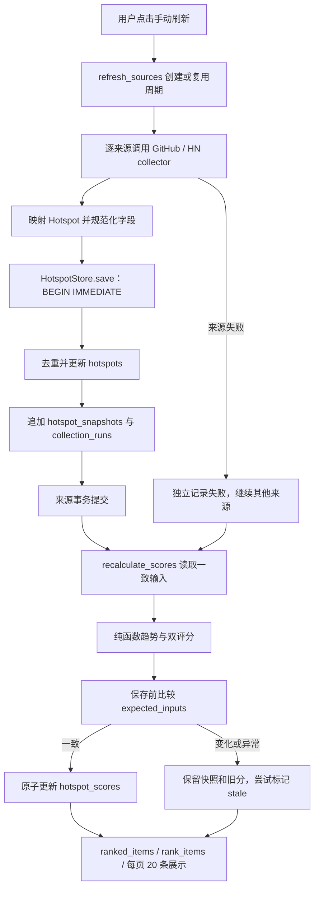
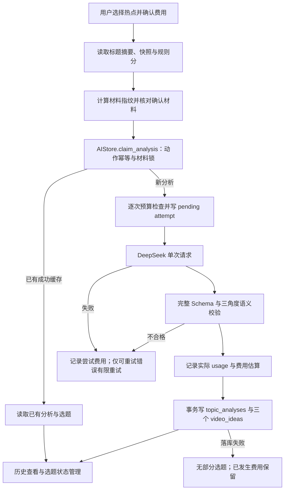
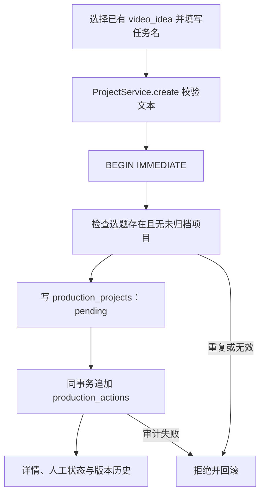
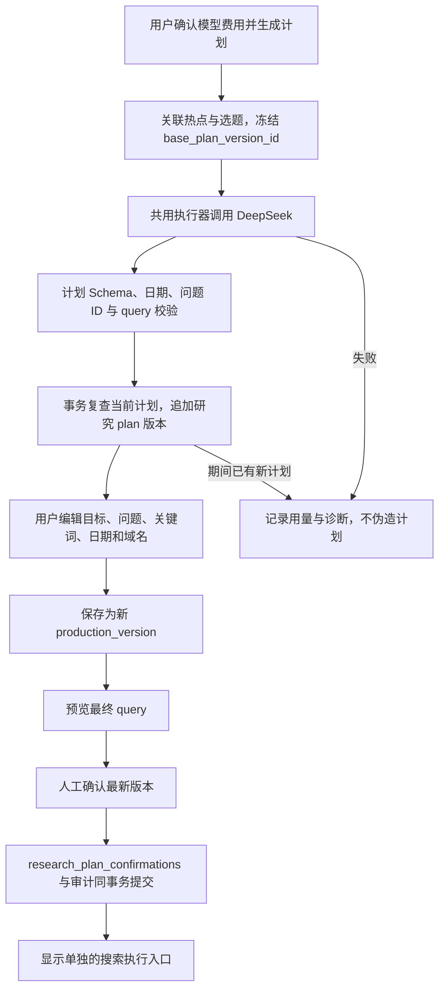
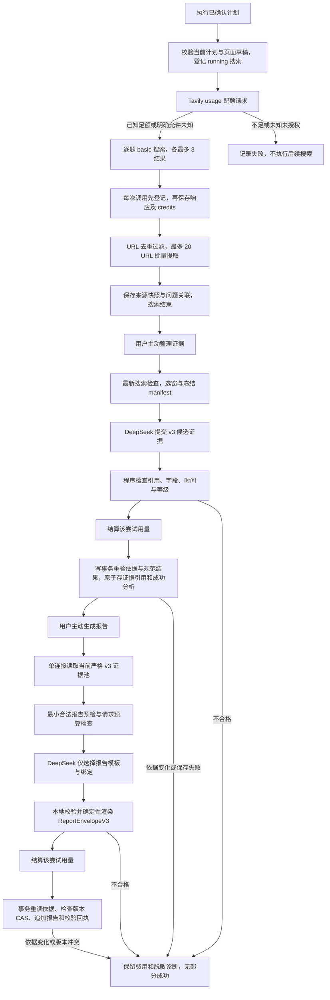
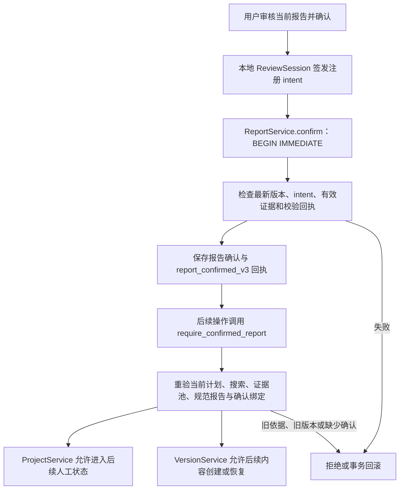

# 核心业务数据流

> 基准：2026-11-06（北京时间）。[架构总入口](../ARCHITECTURE.md)。图中外部服务仅描述现有实现，本次没有发出任何业务 API 请求。

## A 热点从采集到展示

触发：排行页面“手动刷新”；普通查看只查询本地数据。“重新计算评分”从本地快照开始，不经过采集。

执行：GitHub 单次搜索最多 30 个近期活跃仓库；HN 从最多 60 个热门帖详情中筛 AI 内容，最多 6 线程。标题或 URL 等命中会去重；同链接跨来源可关联多个来源快照，但保留主来源语义。快照按 `(cycle_id,hotspot_id,source,source_key)` 去重；快照对采集任务的复合外键延迟至事务提交检查。

异常：网络、认证、限流和格式错误变为固定安全错误；单来源事务失败不影响其他来源。评分失败不撤销已提交快照；保存评分时输入发生变化则拒绝旧计算结果。不存在人工事实审核节点，只有刷新/重算的显式触发。

依据：[app.py · show_dashboard](../../app.py#L161)、[services/refresh.py · refresh_sources](../../services/refresh.py#L18)、[database/store.py · HotspotStore.save](../../database/store.py#L58)、[services/recalculate.py · recalculate_scores](../../services/recalculate.py#L12)、[services/ranking.py · rank_items](../../services/ranking.py#L34)。相关测试：[tests/test_phase2_refresh.py](../../tests/test_phase2_refresh.py#L1)、[tests/test_snapshots.py](../../tests/test_snapshots.py#L1)。

## B 热点转为 AI 选题

触发：AI 选题页单条或批量分析，费用确认与执行按钮分开；批量逐热点执行，不是一次模型请求包办所有热点。

数据库：材料和执行状态在 `topic_analyses`；每次 HTTP 尝试在 `ai_analysis_runs`；三个选题原子保存到 `video_ideas`。收藏/淘汰/选中/待制作等只更新选题及 `idea_actions`，不调用模型、不自动创建制作任务。

外部与确认：只调用 DeepSeek，不访问热点链接；模型结果只是材料基础上的选题建议。未知用量保留预算预占。缓存不收费，`force` 只表示主动追加分析，仍不能绕过预算和动作幂等。

依据：[ai_page.py · show_analysis_controls](../../ai_page.py#L47)、[services/ai/analyzer.py · Analyzer.analyze](../../services/ai/analyzer.py#L85)、[services/ai/executor.py · execute_attempts](../../services/ai/executor.py#L12)、[database/ai_store.py · AIStore.complete_analysis](../../database/ai_store.py#L137)。相关测试：[tests/test_ai_analyzer.py](../../tests/test_ai_analyzer.py#L1)、[tests/test_ai_budget.py](../../tests/test_ai_budget.py#L1)、[tests/test_ai_safety.py](../../tests/test_ai_safety.py#L1)。

## C 选题进入制作工作台

触发：工作台“从已有选题创建制作任务”表单。无需选题先改成某一固定状态。

数据库的部分唯一索引补强并发检查；状态 `completed` 仍属于有效项目。归档后可以从同选题新建项目，旧任务与历史保留。归档为终态，无取消归档实现；暂停记录 `resume_status`，恢复会重新检查目标阶段的报告门禁。

此流程无外部请求；创建/编辑/状态变更由用户显式提交。研究流程由详情页单独进入，不会因创建任务自动调用模型。

依据：[pages/production.py · _creation](../../pages/production.py#L22)、[services/production/project_service.py · ProjectService.create](../../services/production/project_service.py#L35)、[database/production_store.py · ProductionStore.transaction](../../database/production_store.py#L21)、[database/production_migration.py](../../database/production_migration.py#L1)。相关测试：[tests/test_production_service.py](../../tests/test_production_service.py#L1)、[tests/test_production_store.py](../../tests/test_production_store.py#L1)。

## D 研究计划生成与确认

触发：研究区“生成研究计划”需费用确认；人工保存和确认只做本地操作。

也可由服务调用者直接 `save_plan` 保存人工计划，无须先 AI 生成；页面当前从已有计划进入编辑。计划保存使用 `VersionService`，对象为 `(research,plan)`。生成时发现计划改变则拒绝提交；普通人工保存当前没有同等的预期前版本 CAS（审计问题 A07）。

人工确认必须绑定最新版本和 `keywords-v2` 查询构造规则；旧版本恢复或重新保存会追加版本，需要重新确认。query 由去重关键词或人工 override 确定，不把研究问题和来源类型自动拼入搜索词。确认计划不调用 Tavily。

依据：[pages/research.py · _plan_editor](../../pages/research.py#L70)、[services/research/service.py · ResearchService.generate_plan](../../services/research/service.py#L190)、[services/research/service.py · ResearchService.confirm_plan](../../services/research/service.py#L69)、[services/research/queries.py · build_query](../../services/research/queries.py#L7)。相关测试：[tests/test_research_page.py](../../tests/test_research_page.py#L1)、[tests/test_research_workflow.py](../../tests/test_research_workflow.py#L1)。

## E 搜索、来源、证据与报告

触发分三次：主动执行搜索与提取、确认费用后整理证据、确认费用后生成报告。证据与报告也可有失败历史，不能把每一步当成必然成功。

### 搜索与来源

运行写 `research_search_runs`，每次配额/搜索/提取写 `research_search_calls`。quota 读取失败后默认停止；用户显式允许未知配额时才继续。程序按问题数加 4 计算保守 credits 上界，但没有跨项目的 Tavily 原子额度预占账本。

每次搜索前与批量提取前复查计划和运行状态；计划改变或人工中断会停止后续调用。部分来源失败仍保存已获得结果。正文失败可保留搜索摘录，状态明确为失败。来源按 `(project_id,url_key,content_hash)` 复用或追加，问题关联保存 run 与 question_id；来源首次保存时间不等于原文更新时间。

### 证据

来源完整 text/snippet 留在数据库及冻结输入，模型只接收相关可见窗口。坐标使用 Python Unicode 码点的 `[start,end)`，输入预算按 UTF-8 请求字节控制，不是同一计量。来源、正文、窗口、问题、hash 及逐字引句均需核对；唯一可见匹配允许纠正引用定位并留决策日志，歧义匹配拒绝。

`quality.assess_batch` 输出最终分类和时间结果；模型不能提供最终等级或审核授权。写事务重新执行公开判定、核对冻结来源和 SQL/JSON 投影后，一起保存 `research_evidence`、`research_evidence_sources`、分析结果与事件。Provider 尝试费用先独立保存，业务回滚不抹掉费用。

### 报告

`read_bundle` 必须读当前确认计划、最新有效搜索、该搜索最新成功证据分析；若选中的最新成功分析是 legacy，不跳回更早 v3 分析。报告只接受当前 v3 池；完整保留全部证据和缺口。报告模型没有自由正文通道，数值、期间、等级和引用由程序继承。

`ReportService._publish` 在写事务内重建当前依据并校验 envelope，检查预期前报告版本；新增 `production_versions`、校验审计、更新时间与成功 analysis 同事务提交。人工保存使用同一校验和 CAS，但不调用模型；恢复历史 v3 报告也必须与当前依据匹配，追加后重新确认。

依据：[services/research/service.py · ResearchService.search](../../services/research/service.py#L100)、[database/research_store.py · ResearchStore.save_sources](../../database/research_store.py#L59)、[services/research/service.py · ResearchService.organize_evidence](../../services/research/service.py#L197)、[services/research/quality.py · assess_batch](../../services/research/quality.py#L463)、[database/research_store.py · ResearchStore.verify_evidence_binding](../../database/research_store.py#L231)、[services/research/report_evidence.py · read_bundle](../../services/research/report_evidence.py#L16)、[services/research/report_service.py · ReportService._publish](../../services/research/report_service.py#L95)。相关测试：[tests/test_research_quality_integration.py](../../tests/test_research_quality_integration.py#L1)、[tests/test_research_quality_persistence.py](../../tests/test_research_quality_persistence.py#L1)、[tests/test_research_report_integration.py](../../tests/test_research_report_integration.py#L1)、[tests/test_research_report_persistence.py](../../tests/test_research_report_persistence.py#L1)。

## F 报告确认与后续制作

触发：页面展示报告，用户勾选审核并点击“确认研究报告”。模型生成成功、普通 UUID 或项目 `status` 字段本身都不是确认授权。

intent 绑定 project、report version、core hash、evidence set hash、policy、purpose、session 和 nonce；未提交意图有效期 600 秒。成功确认写 `research_report_confirmations` 和 `production_actions`，提交后登记意图已使用。相同动作可幂等重入，不能转用于其他报告。

新的计划版本、搜索或证据批次可能使旧报告失效；新一次报告生成失败但旧依据未变时，旧确认仍可有效。历史确认行不删除，准入检查当前绑定，不只检查“有确认记录”。

人工确认是本地单用户操作，既不是证据等级提升，也不是多人身份认证。当前“进入脚本制作阶段”只调用 `set_status('scripting')`；脚本实际生成与编辑尚未实现。制作准入规则也不保证以后任意脚本文字均正确引用研究事实，未来内容业务仍需自己的契约。

依据：[pages/research.py · _report_area](../../pages/research.py#L233)、[services/research/report_confirmation.py · LocalReportReviewSession.reviewed](../../services/research/report_confirmation.py#L22)、[services/research/report_confirmation.py · verify_intent](../../services/research/report_confirmation.py#L35)、[services/research/report_service.py · ReportService.confirm](../../services/research/report_service.py#L217)、[services/research/report_service.py · require_confirmed_report](../../services/research/report_service.py#L59)、[services/production/project_service.py · ProjectService._transition](../../services/production/project_service.py#L77)、[services/production/version_service.py · VersionService.restore](../../services/production/version_service.py#L61)。

## 事务与失败边界汇总

| 操作 | 原子提交范围 | 外部请求期间持有业务写事务 | 失败保留 |
| --- | --- | --- | --- |
| 单来源刷新 | 热点、快照、来源任务 | 否 | 其他来源结果；失败任务独立登记 |
| 评分重算 | 当前全部评分 | 否 | 来源快照、旧评分，尝试标过期 |
| 一次 AI 尝试 | 预算预占与调用记录，结算另事务 | 否 | 已知用量或未知预占 |
| AI 选题成功 | 分析结果与三个选题 | 否 | 调用账本 |
| 创建/编辑制作任务 | 任务变更与审计 | 无外部请求 | 旧任务和历史 |
| 搜索 | 运行/单次请求/来源分段落库 | 否 | 已发请求与已取得来源，可能部分成功 |
| 证据入库 | 证据、引用、成功分析与审计 | 否 | 费用、失败状态与可得诊断 |
| 报告发布 | 版本、校验回执、项目时间与成功分析 | 否 | 费用和旧报告 |
| 报告确认 | 确认记录与确认回执 | 无外部请求 | 旧确认与版本 |

数据库结构及约束详见 [数据库设计](DATABASE_DESIGN.md)；费用与有限重试详见 [AI 架构](AI_ARCHITECTURE.md)。
