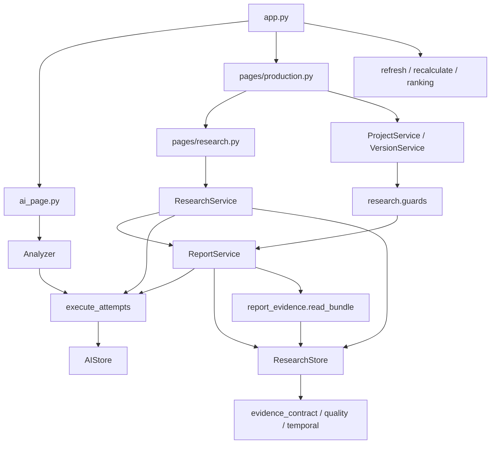

# 系统总览

> 基准：2026-11-06（北京时间）。[架构总入口](../ARCHITECTURE.md)。范围是当前工作区；所有示意图描述现有实现。

## 运行与部署结构

产品名为 ai-hotspot-radar，实际 Git 根目录为 `E:\one\ai-hotspot-radar`。会话默认目录 `C:\Users\28565\.codex\visualizations\2026\11\05\01a1aaa5-09dc-74b1-ad9d-2f097b340e71` 不是本项目根目录；本套文档均新增于实际项目中。

Streamlit 以 `app.py` 为入口，同进程导入页面、Python 服务、requests 客户端和 SQLite Store。没有独立的 REST 后端、ORM、Redis、消息队列或向量数据库实现。只读浏览通常不调用外部 API，但 Store 初始化可能创建表、迁移结构，AIStore 首次初始化可能插入预算，不能把“页面不联网”等同“初始化完全只读”。依据：[app.py · main](../../app.py#L235)、[database/store.py · HotspotStore.__init__](../../database/store.py#L19)、[database/ai_store.py · AIStore.__init__](../../database/ai_store.py#L24)。

既有 README 的本机启动命令如下，仅作为运行说明；本次审计未启动服务：

```powershell
.\.venv\Scripts\python.exe -m streamlit run app.py --server.address 127.0.0.1 --server.port 8501 --server.headless true --browser.gatherUsageStats false
```

页面重跑通过 `st.session_state` 保存当前选择、动作 ID、草稿和提示；数据库保存跨会话的任务状态、幂等锁、预算和历史。外部请求同步执行，服务没有自动恢复运行中请求的后台机制；中断需要人工确认。HN 的线程池仅用于一次采集的详情并发，不是持久任务队列。

## 目录与职责

```text
ai-hotspot-radar/
├── app.py                         统一导航、排行、刷新和评分展示
├── ai_page.py                     AI 候选、分析确认、选题与预算
├── config.py                      项目根路径与配置加载
├── models.py                      Hotspot / CollectionResult / 时间与指标处理
├── requirements.txt               固定五项直接依赖
├── pytest.ini                     测试目录与简洁输出
├── collectors/
│   ├── http.py                    采集 HTTP、超时与安全异常
│   ├── github.py                  GitHub 仓库搜索映射
│   └── hacker_news.py             HN 热门样本、关键词与并发详情
├── pages/
│   ├── production.py              制作任务、状态、历史与研究入口
│   └── research.py                计划、搜索、证据、报告四区
├── services/
│   ├── normalization.py           标题 URL 与 HTML 纯文本处理
│   ├── refresh.py                 来源故障隔离、刷新与评分衔接
│   ├── trends.py                  同来源对象的观察区间增长
│   ├── scoring_rules.py           权重、锚点、时效阈值和词表
│   ├── scoring.py                 纯函数双评分及解释
│   ├── recalculate.py             离线重算与并发输入检查
│   ├── ranking.py                 已存分数筛选、排序与过期判断
│   ├── ai/                        Provider、Prompt、Schema、执行器与计费
│   ├── production/                任务状态、版本与同事务审计
│   └── research/                  搜索、材料、质量、时间、报告及确认
├── database/
│   ├── store.py                   HotspotStore 与短连接
│   ├── ai_store.py                AI 分析、调用账本、预算与选题
│   ├── production_store.py        制作事务、任务、对象与版本 SQL
│   ├── research_store.py          来源、搜索、证据、诊断及绑定校验
│   ├── migrations.py              user_version 与升级备份编排
│   ├── ai_migration.py            v3 AI 表
│   ├── production_migration.py    v4 制作表
│   ├── research_migration.py      v5 研究表及分析扩展
│   └── research_quality_migration.py  v6 诊断表
├── tests/
│   ├── conftest.py                配置、网络、生产数据库隔离
│   ├── test_*.py                  33 个测试入口模块
│   ├── research_*cases.py         参数化研究场景
│   ├── research_support.py        明确 Mock 的回归夹具适配
│   └── fixtures/research_quality/ 固定原文与元数据样本
├── docs/
│   ├── ARCHITECTURE.md            新架构总入口
│   ├── architecture/             七份架构专题
│   ├── ARCHITECTURE_AUDIT_REPORT.md  本次审计与验证结果
│   ├── plan&report/               已有阶段计划和验收报告
│   └── *.docx                    已有产品愿景与文档模板
├── REPORT_*.md                    尚位于根目录的已有阶段报告
├── data/                         默认数据库及历史升级备份，不展开
├── logs/                         历史测试和联调产物，不展开
├── .venv/                        本地运行环境，不展开
├── __pycache__/ 和 .pytest_cache/ 运行缓存，不展开
└── .env                          本地配置文件，本次禁止读取
```

树是重要文件的职责地图，不是全部文件枚举。各 `__init__.py` 主要标记包及说明。目录树中的架构文档是本次新增内容；其他项目文件原样保留。

## 页面与服务边界

导航由 `app.main` 的侧栏单选控制，三个主页面为“热点排行”“AI 选题分析”“视频制作工作台”。`pages/research.py` 是工作台详情中的组件，不是第四个独立主导航。`client.showSidebarNavigation=False` 隐藏 Streamlit 自动页面菜单；production 直接页面入口会回到主应用导航。依据：[app.py · main](../../app.py#L235)、[pages/production.py · show_production_page](../../pages/production.py#L160)、[pages/research.py · show_research](../../pages/research.py#L324)。

| 层或角色 | 当前职责 | 边界限制 |
| --- | --- | --- |
| 页面 | 收集显式操作、生成动作 ID、费用/审核确认、展示本地结果 | 部分页面直接读 SQL 与 Store 私有连接，不是完全独立的展示层 |
| 应用服务 | 采集编排、分析、项目状态、研究流程、报告发布 | 研究/报告服务也含 SQL 和事务逻辑 |
| 纯规则模块 | 评分、选窗、日期、质量判定、报告校验与渲染 | 纯函数只说明无外部副作用，不说明能证明现实事实为真 |
| 数据访问 | 参数化 SQL、短连接、事务和部分持久化前复核 | ResearchStore 为防绕过会回调质量模块 |
| 外部适配 | REST 请求、响应映射、超时与固定安全错误 | Provider 不负责重试、业务确认或独立持久化 |

## 真实依赖关系



图展示关键调用/导入依赖，包含延迟导入，不表示每个服务只依赖图中对象。`ReportService` 与 `ResearchStore`、`guards`、版本服务之间通过延迟导入规避循环导入；后续维护不能简单按“database 层绝不依赖 services”理解现状。依据：[services/research/report_evidence.py · read_bundle](../../services/research/report_evidence.py#L16)、[services/research/guards.py · require_report](../../services/research/guards.py#L54)、[database/research_store.py · ResearchStore.verify_evidence_binding](../../database/research_store.py#L231)。

Store 的实际继承为：`AIStore → HotspotStore`，`ProductionStore → HotspotStore`，`ResearchStore → ProductionStore → HotspotStore`。不同 Store 连接同一 SQLite 文件，不是不同数据库；ProductionStore.ideas 的返回值与 AIStore.ideas 不同，应按具体类型使用。

## 状态与持久化

- 排行读取已保存评分；缺失值保留 NULL，旧指标不伪造成当前趋势。
- 分析与调用使用不同状态：分析可为 `running/success/failed/uncertain`，一次 HTTP 尝试为 `pending/success/failed`。
- 制作状态是人工标记，可暂停并恢复原状态，归档为终态；进入脚本及后续状态需当前有效且人工确认的报告。
- 研究搜索按项目限制一条 `running`；计划或搜索依据变化会阻断后续步骤，旧数据仍可查看。
- 报告当前有效状态与最近生成尝试分别展示；一次新生成失败，在依据不变时不自动作废旧的已确认报告。

依据：[services/production/project_service.py · ProjectService._transition](../../services/production/project_service.py#L77)、[services/research/service.py · ResearchService.search](../../services/research/service.py#L100)、[services/research/report_service.py · ReportService.state](../../services/research/report_service.py#L250)。

## 日志与本地数据

`app.main` 配置应用 logger 的 StreamHandler，默认输出到终端；服务记录 ID、统计和错误类型。代码没有把 `logs/` 配置成统一运行日志目录，目录中的文件主要是既有验收脚本和人工联调产物，不能假设启动即生成其中所有日志。

业务库、升级备份、日志、缓存和 `.env` 在 `.gitignore` 排除规则中；这只是 Git 忽略策略，不是文件加密或权限隔离。源码使用固定安全错误与纯文本展示，仍应把本地数据库视为含研究内容和调用信息的业务文件。依据：[.gitignore](../../.gitignore#L1)、[app.py · main](../../app.py#L235)、[services/ai/base.py · AIError](../../services/ai/base.py#L38)。

本次只读观察默认数据库，未读取 `.env` 和进程配置，因此无法确认实际运行进程是否覆盖了数据库路径、模型或价格。架构文档不假定存在正在运行的服务。
